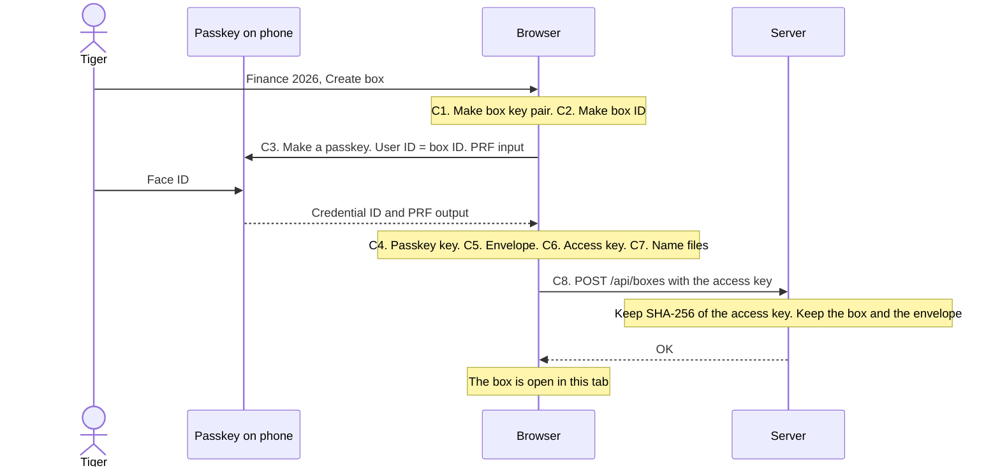
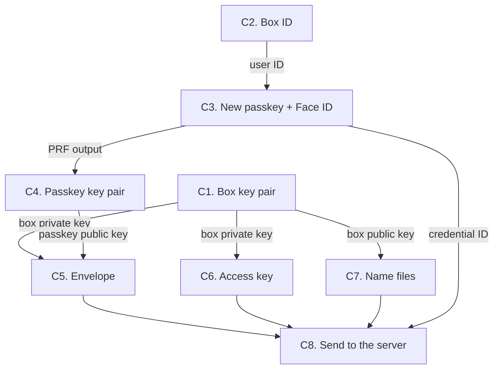

# 1. A person makes a box

[← All documents](README.md) · [Word list](README.md#the-words-in-these-documents)

## In short

Tiger makes the box "Finance 2026". He makes no account and types no email address.

His phone makes a new passkey for this box only. The passkey gives a key that locks the box private key in an **envelope**. The server keeps the envelope, but only Tiger's passkey can unlock it.

Tiger uses Face ID one time. Some devices ask two times.

## What Tiger sees

1. Open Vault Box.
2. Type a box name ("Finance 2026"). There is no name to type for yourself: in the box, the person who made it is "You".
3. Select **Create box**.
4. The phone asks to save a passkey with the name "Finance 2026". Confirm with Face ID.
5. The box opens. It is empty.

## What happens, in plain words

1. The browser makes a new key pair for the box: the **box key**.
2. The browser makes a random **box ID**.
3. The phone makes a new passkey. The box ID becomes the passkey's user ID.
4. With the same Face ID, the passkey gives its **PRF output**. This output is the private key of Tiger's **passkey key**.
5. The browser locks the box private key with the passkey public key. The result is Tiger's **envelope**.
6. The browser calculates the **access key** from the box private key.
7. The browser locks the box name with the box public key. It also locks Tiger's name file. The name in it is empty: nobody has named the person who made the box. The app shows Tiger as "You".
8. The browser sends all of this to the server. The server keeps only the hash of the access key.

## Who talks to whom



The phone keeps the passkey. The browser keeps the box private key and the access key in tab memory only.

## How the keys flow



## Steps: input, method, output

| Step | Input | Method | Output | Goes to |
|---|---|---|---|---|
| C1. Box key pair | Random bytes. | X25519 key generation (`age.generateX25519Identity`). | Box private key `AGE-SECRET-KEY-1Z84DDGND8U…`. Box public key `age13aa297n0wgzsleu3…` | C5, C6, C7, C8 |
| C2. Box ID | Random bytes. | 16 random bytes, in base64url. | `nbtYKFvPJE6MnspnIVuu4Q` | C3, C8 |
| C3. Make the passkey | The box ID (C2) as the user ID. The label "Finance 2026". The PRF input `secretbox passkey key v1`. | WebAuthn `navigator.credentials.create` with the PRF extension. Tiger confirms with Face ID. | Credential ID `BB-I_WwmhQyoq3USEVPrvA`. PRF output `9fcc080d2bd5d392…` | C4, C8 |
| C4. Passkey key pair | The PRF output (C3), 32 bytes. | The 32 bytes are the X25519 private key. Bech32 writes it as text. X25519 calculates the public key. | Private key `AGE-SECRET-KEY-1NLXQSRFT6H…`. Public key `age18wcj2lnje95fkz4c…` | C5. The private key stays in tab memory. |
| C5. Envelope | The box private key (C1). The passkey public key (C4). | The age recipe with an X25519 stanza: file key `e8098c57…`, temporary public part `GiOSDxXQXStQbk9I…`, shared secret `37a1bb8e7b86476d…`, wrap key `be7f72ee0358b8ca…`. | The envelope, 274 bytes. Its payload holds the box private key (74 characters). | C8 |
| C6. Access key | The box private key (C1), as 32 bytes `11ead6a26d3f3858…`. | HMAC-SHA-256 with the box private key as the key, and the text `secretbox access key v1`. Then base64url. | `-opAqacwlYsMBtzqm8OLNy6fM6xa3MBHIPav8AuUxBI` | C8 |
| C7. Name files | The text `Finance 2026`. The text `{"name":"","invitedBy":null}` (an empty name). The box public key (C1). | The age recipe with an X25519 stanza, one time for each text. | The box name file, 212 bytes. Tiger's name file, 228 bytes. | C8 |
| C8. Send | All the outputs above. | `POST /api/boxes`. The header `Authorization: Bearer` holds the access key. | The server calculates SHA-256 of the access key: `1ee2b4af37da3c39…`. It keeps that hash, the box row and the member row. | [Scenario 2](02-open-box.md) |

Tiger's envelope, as the server keeps it:

```
age-encryption.org/v1
-> X25519 GiOSDxXQXStQbk9IwxQxL95kV33YVdVLWt36uX7ToRw
cBISyKUSsi5ezrLzCM+Aot3pZ8FI6ABIkolpPcdZPeI
--- AbJEQMVyEqSnodxoCStX0CAWDJ51An+beTsbnbBG7DM
[106 bytes: the box private key, locked]
```

The envelope does not show the passkey public key. age does not write the recipient in the file. So the server cannot know which passkey key unlocks an envelope.

**Two Face IDs on some devices.** Some phones and password managers give the PRF output only when a person **uses** a passkey, not when they **make** it. Then the browser asks for the new passkey one more time, right after step C3. The result is the same.

## The keys in this part

| Key | Secret? | Where it lives | What it does |
|---|---|---|---|
| Passkey | Yes | In the phone or password manager. Apple and Google sync it to the person's other devices. | Gives the PRF output after Face ID. |
| Passkey key pair | Yes (private part) | Nowhere. The browser calculates it again from the PRF output each time. | Locks and unlocks the envelope. |
| Box key pair | Yes (private part) | In each envelope, locked. In tab memory while the box is open. | Locks and unlocks items and names. Gives the access key. |
| Access key | Yes | In tab memory. The server keeps only its hash. | Lets the browser use the box on the server. |

## A second box

Later, Tiger makes the box "HR 2027". The steps are the same. Each value is new:

| Value | Finance 2026 | HR 2027 |
|---|---|---|
| Box ID (the passkey user ID) | `nbtYKFvPJE6MnspnIVuu4Q` | `ZtyxjgXwP6m0Y13hJH1-Ow` |
| Passkey label | Finance 2026 | HR 2027 |
| PRF input | `secretbox passkey key v1` | `secretbox passkey key v1` (the same) |
| PRF output | `9fcc080d2bd5d392…` | `1c4f3378f947bddb…` (different passkey, different output) |
| Passkey public key | `age18wcj2lnje95fkz4c…` | `age1veh88r5ce3axg4xm…` |
| Box public key | `age13aa297n0wgzsleu3…` | `age1wf2xenv5633sar32…` |
| Access key | `-opAqacwlYsMBtzq…` | `ApFLUR7KiylHQXFh…` |

Now Tiger's phone shows two passkeys for Vault Box:

```
vlt.i7r.tech
  ├─ Finance 2026    (user ID nbtYKFvPJE6MnspnIVuu4Q)
  └─ HR 2027         (user ID ZtyxjgXwP6m0Y13hJH1-Ow)
```

**Why one passkey for each box?**

- There is no account. The passkey list on the phone is the list of Tiger's boxes.
- When Tiger opens a box, the passkey that he selects tells the browser which box to open. See [scenario 2](02-open-box.md).
- A phone keeps one passkey for each user ID on a site. A new passkey with the same user ID replaces the old one. So each box must have its own user ID, and the box ID is a good choice.

## Result

| Where | What |
|---|---|
| Phone or password manager | The passkey "Finance 2026". |
| Server | The box ID, the box public key, the box name file, the access hash. One member row: the credential ID, the envelope, Tiger's name file. |
| Browser tab memory | The box private key and the access key, until the box locks (see [Lock, reload and close](02-open-box.md#lock-reload-and-close)). Where the browser can, the box private key is a key object that scripts cannot read. |

| Action | Face ID |
|---|---|
| Make a box | 1 (2 on some devices) |

## Technical details

- [Passkey PRF: from a passkey to a passkey key (steps C3 and C4)](technical/passkey-prf.md)
- [The X25519 stanza, step by step (steps C5 and C7)](technical/age-format.md)
- [The access key (step C6)](technical/passkeys-and-access-keys.md)
- [API calls and database statements (step C8)](technical/api-and-sql.md)

[← All documents](README.md) · [Next: a member opens a box later →](02-open-box.md)
