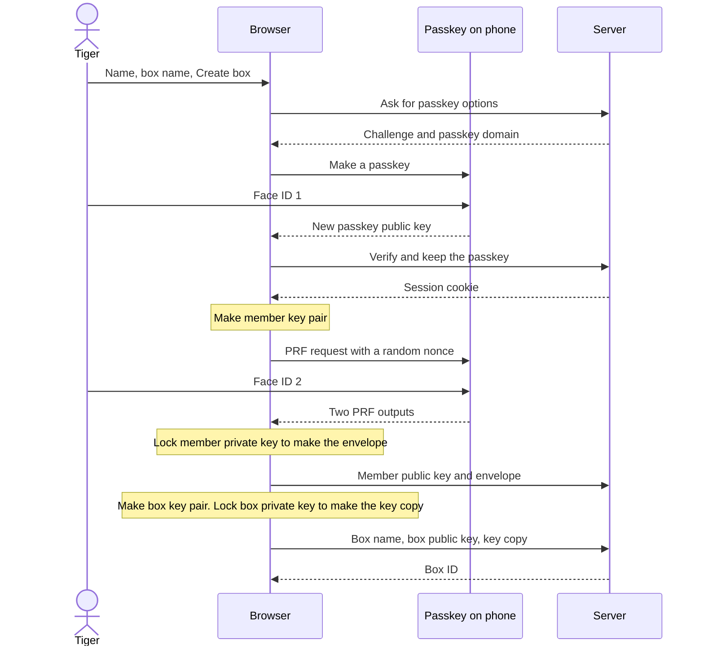
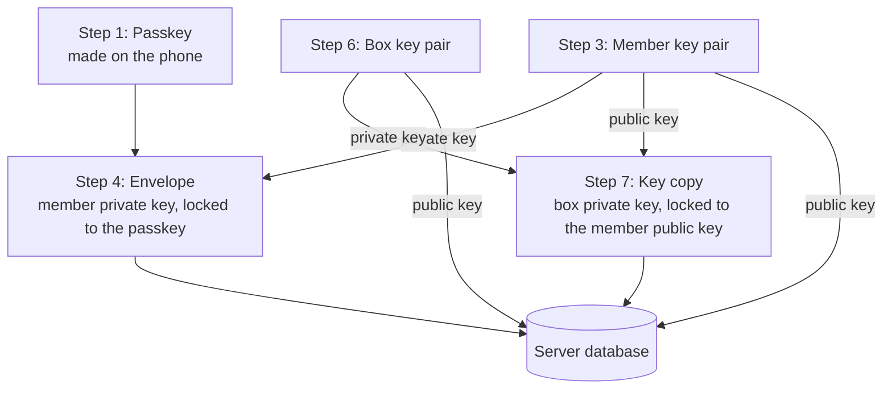

# 1. A new person makes an account and a box

[← All documents](README.md) · [Word list](README.md#the-words-in-these-documents)

## In short

Tiger is new. He types his name and a box name. His phone asks for Face ID two times. Then his box is ready.

During these steps, the system makes three things for Tiger:

- a **passkey** on his phone,
- a **member key** for him,
- a **box key** for the box.

The server keeps public keys, locked files and names. It cannot open the locked files.

## What Tiger sees

1. Open the Secretbox page.
2. Type a name ("Tiger") and a box name ("Finance 2026").
3. Select **Create box**.
4. Confirm with Face ID. The phone makes a passkey.
5. Confirm with Face ID again. The phone locks his member key.
6. The box page opens.

## What happens, in plain words

1. The phone makes a passkey. The server keeps the passkey's public key and signs Tiger in.
2. The browser makes Tiger's member key pair.
3. The passkey locks the member private key. The result is the **envelope**.
4. The browser makes the box key pair.
5. The member public key locks the box private key. The result is Tiger's **key copy**.
6. The server keeps the envelope, the key copy and the two public keys.

## Who talks to whom



## How the keys flow

Each arrow shows that one output goes into the next step.



## Steps: input, method, output

| Step | Input | Method | Output | Goes to |
|---|---|---|---|---|
| 1. Make the passkey | A challenge from the server. The passkey domain `secretbox-nu.vercel.app`. | WebAuthn registration. Face ID 1. | A passkey. Credential ID `nIqF2ASScSdBg5JqLm1Kcw`. A public key for sign-in. A hidden PRF secret that stays on the phone. | Steps 2 and 4 |
| 2. Sign in | The passkey response from step 1. | The server verifies the challenge, the address, the passkey domain and Face ID use. | A session token `vjCmUsAHogdl4B-Y…` in a cookie. The server keeps only its SHA-256 `a01c59a2922989…`. | All later requests |
| 3. Make the member key | Random bytes. | X25519 key generation. | Private key `AGE-SECRET-KEY-1XZZ8PLLYDCJ…`. Public key `age1gffpl2mrf5g92mje…`. | Private key → step 4. Public key → steps 5 and 7. |
| 4. Lock the member private key | The member private key (step 3). The passkey (step 1). | age file with a **fido2prf** stanza. Face ID 2. | The **envelope**, 274 bytes. | Step 5 |
| 5. Keep the member key | The member public key (step 3). The envelope (step 4). | `PUT /api/me/keys` | The server keeps both. | Later unlocks |
| 6. Make the box key | Random bytes. | X25519 key generation. | Private key `AGE-SECRET-KEY-1TECYTY27F3E…`. Public key `age1cmaf95n0vkusfv0s…`. | Private key → step 7. Public key → step 8. |
| 7. Lock the box private key | The box private key (step 6). The member public key (step 3). | age file with an **X25519** stanza. No Face ID. | Tiger's **key copy**, 274 bytes. | Step 8 |
| 8. Keep the box | The box name. The box public key (step 6). The key copy (step 7). | `POST /api/boxes` | A box row. A membership row with the role "admin". | Scenarios 3 and 4 |

### Inside step 4: how the envelope is made

The browser uses the age file recipe. The passkey locks the file key.

| Part | Input | Method | Output | Goes to |
|---|---|---|---|---|
| 4a. File key | Random bytes. | Random 16 bytes. | `bd991a3d7a99a5c2f3863b04757ce9ee` | 4d, 4e, 4f |
| 4b. Nonce | Random bytes. | Random 16 bytes. | `rz/XB5+tax7mwcIJowbCPQ` | 4c, and the stanza line |
| 4c. PRF outputs | The nonce (4b). Face ID. The hidden passkey secret. | PRF: HMAC-SHA-256 inside the phone, two times. | `add6282257e13a4c…` and `752b4f4795cd974d…` | 4d |
| 4d. Lock the file key | The two PRF outputs (4c). The file key (4a). | HKDF-SHA-256 makes the wrap key `7b1ee88fcb85256e…`. ChaCha20-Poly1305 locks the file key. | Stanza body `xnsO+7fJA1pe0ly2…` | The header |
| 4e. Header check | The file key (4a). The header. | HKDF-SHA-256, then HMAC-SHA-256. | MAC `ar2lATuHJ0mfj7NO…` | The header |
| 4f. Payload | The file key (4a). The member private key (step 3). | HKDF-SHA-256 makes the payload key `128a70d77bc8c433…`. ChaCha20-Poly1305 locks the data. | 106 bytes: a 16-byte nonce, the 74-byte private key locked, a 16-byte tag. | The envelope |

The envelope:

```
age-encryption.org/v1
-> age-encryption.org/fido2prf rz/XB5+tax7mwcIJowbCPQ
xnsO+7fJA1pe0ly2jfVIiOX/HbmnRrUdu+31Z4b8MLM
--- ar2lATuHJ0mfj7NOp/nYk2qYvvb/GU82Zs+boN28BJQ
[106 bytes: Tiger's member private key, locked]
```

### Inside step 7: how the key copy is made

The browser uses the same recipe. This time, a public key locks the file key. No Face ID is necessary.

| Part | Input | Method | Output | Goes to |
|---|---|---|---|---|
| 7a. File key | Random bytes. | Random 16 bytes. | `9aa2522df221d6691d9181f16fc1baad` | 7d, 7e, 7f |
| 7b. Temporary key pair | Random bytes. | X25519 key generation. | Temporary public part `qj0vsVPNwwInsjLR…` | 7c, and the stanza line |
| 7c. Shared secret | The temporary private part (7b). The member public key (step 3). | X25519 | `069cfb215096db27…` | 7d |
| 7d. Lock the file key | The shared secret (7c). The file key (7a). | HKDF-SHA-256 makes the wrap key `fe7602f3b9bae134…`. ChaCha20-Poly1305 locks the file key. | Stanza body `y5ajlMOW+twlhmme…` | The header |
| 7e. Header check | The file key (7a). The header. | HKDF-SHA-256, then HMAC-SHA-256. | MAC `MBk+JfXYk0hjI7hl…` | The header |
| 7f. Payload | The file key (7a). The box private key (step 6). | HKDF-SHA-256 makes the payload key `3964fea0780c7ef8…`. ChaCha20-Poly1305 locks the data. | 106 bytes | The key copy |

The key copy:

```
age-encryption.org/v1
-> X25519 qj0vsVPNwwInsjLRyZMT3+px+AA4fOuD/4zteWjAUiI
y5ajlMOW+twlhmmeK2CcMcikDO5kc9c8JW6jEcEn5QE
--- MBk+JfXYk0hjI7hlSZ0WtBzapHxU05F4A3pDf9BWdNc
[106 bytes: the box private key, locked]
```

## Result

| Where | What |
|---|---|
| Phone | The passkey and its hidden PRF secret. They never leave the phone. |
| Browser tab memory | The member private key. It stays until Tiger closes the tab or selects **Lock**. |
| Server | Tiger's nickname. The passkey public key. The member public key. The envelope. The box public key. The key copy. The hash of the session token. |
| Nowhere | Nobody keeps the box private key in a readable form. At this moment, Tiger's key copy is its only copy. |

**Face ID count:** 2.

## Technical details

- [Passkey sign-up and sessions](technical/webauthn-and-sessions.md)
- [The fido2prf stanza (step 4)](technical/passkey-prf.md)
- [The X25519 stanza, header check and payload (step 7)](technical/age-format.md)
- [API calls and database statements](technical/api-and-sql.md)

[Next: a person with an account makes a new box →](02-existing-user-new-box.md)
