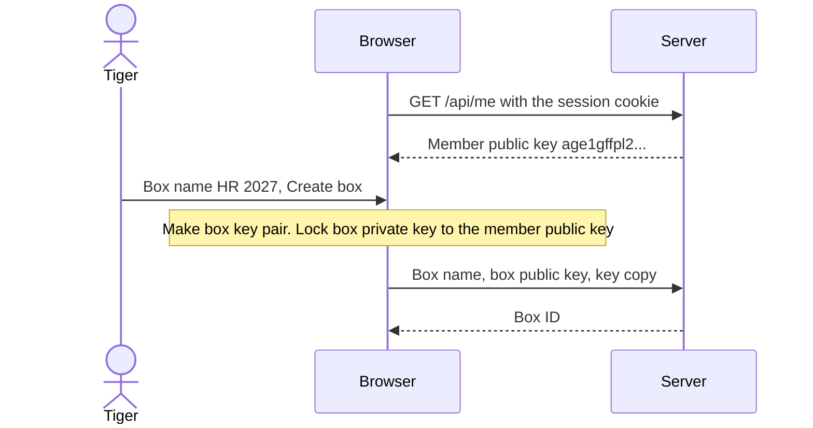
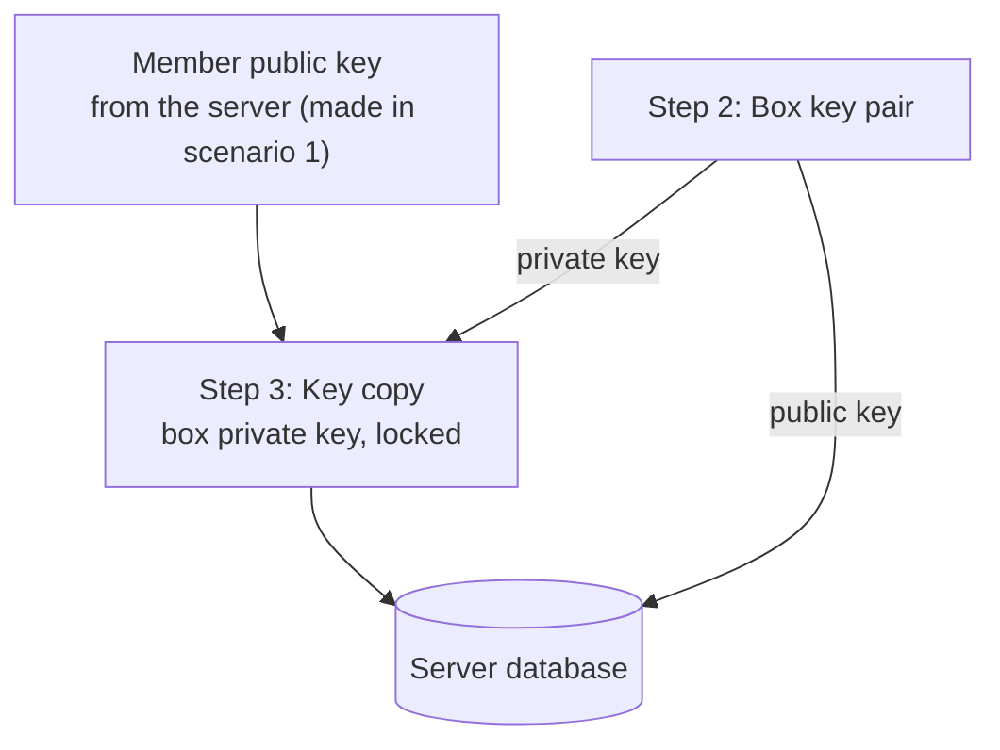

# 2. A person with an account makes a new box

[← All documents](README.md) · [Word list](README.md#the-words-in-these-documents)

## In short

Tiger already has an account. He makes a second box, "HR 2027". He does not need Face ID.

The browser needs only Tiger's member **public** key. A public key can lock, so the browser can lock the new box key without Tiger's passkey.

## What Tiger sees

1. Open the Secretbox page. Tiger is signed in.
2. Under **New box**, type "HR 2027".
3. Select **Create box**.
4. The box page opens.

If Tiger's sign-in expired (after 30 days), he must sign in first. That is 1 Face ID.

## What happens, in plain words

1. The browser asks the server for Tiger's member public key.
2. The browser makes a new box key pair.
3. Tiger's member public key locks the box private key. The result is his key copy for this box.
4. The server keeps the box public key and the key copy.

## Who talks to whom



## How the keys flow



## Steps: input, method, output

| Step | Input | Method | Output | Goes to |
|---|---|---|---|---|
| 1. Get the member public key | The session cookie. | `GET /api/me` | Member public key `age1gffpl2mrf5g92mje…` | Step 3 |
| 2. Make the box key | Random bytes. | X25519 key generation. | Private key `AGE-SECRET-KEY-132C4K2987NN…`. Public key `age1g65kgg6w726z4638…`. | Private key → step 3. Public key → step 4. |
| 3. Lock the box private key | The box private key (step 2). The member public key (step 1). | age file with an **X25519** stanza. | Tiger's key copy for "HR 2027", 274 bytes. | Step 4 |
| 4. Keep the box | The box name. The box public key (step 2). The key copy (step 3). | `POST /api/boxes` | A box row. A membership row with Tiger's name. | Scenarios 3 and 4 |

### Inside step 3: how the key copy is made

| Part | Input | Method | Output | Goes to |
|---|---|---|---|---|
| 3a. File key | Random bytes. | Random 16 bytes. | `ce985b143132aa041958ac80b60fb71d` | 3d, 3e, 3f |
| 3b. Temporary key pair | Random bytes. | X25519 key generation. | Temporary public part `Ci1h2I6MhyQPVvhe…` | 3c, and the stanza line |
| 3c. Shared secret | The temporary private part (3b). The member public key (step 1). | X25519 | `a1adea1085b58869…` | 3d |
| 3d. Lock the file key | The shared secret (3c). The file key (3a). | HKDF-SHA-256 makes the wrap key `286f36c6a63ee2ce…`. ChaCha20-Poly1305 locks the file key. | Stanza body `3TopJwah6RRcAda8…` | The header |
| 3e. Header check | The file key (3a). The header. | HKDF-SHA-256, then HMAC-SHA-256. | MAC `05A2XsUoKJ8rATEa…` | The header |
| 3f. Payload | The file key (3a). The box private key (step 2). | HKDF-SHA-256 makes the payload key `8b485343f0871553…`. ChaCha20-Poly1305 locks the data. | 106 bytes | The key copy |

The key copy:

```
age-encryption.org/v1
-> X25519 Ci1h2I6MhyQPVvhe28JPp3gDTmJRzJ/ph5FMOat/aWU
3TopJwah6RRcAda8Ku9RviCQaBUhskFdJYsJ0DavumY
--- 05A2XsUoKJ8rATEagOcSWIoc9MrTDyv/ZcUdvnGnKiE
[106 bytes: the "HR 2027" box private key, locked]
```

## Compare with scenario 1

| | Scenario 1 (new person) | Scenario 2 (account exists) |
|---|---|---|
| Make a passkey | Yes | No |
| Make a member key | Yes | No. The browser uses the existing member public key. |
| Make a box key | Yes | Yes |
| Face ID | 2 | 0 (1 if the sign-in expired) |

## Why no Face ID is necessary

Locking needs only a public key. The member public key is not secret, so the server can give it to the browser. Unlocking needs the member private key, and only Tiger's passkey can open the envelope that holds it.

## Result

| Where | What |
|---|---|
| Server | A new box row with the box public key. A new key copy for Tiger. |
| Browser tab memory | Nothing new. The new box private key is not kept. |

To read the new box later, Tiger unlocks his envelope (1 Face ID, if the tab is locked). See [scenario 3](03-add-item.md).

## Technical details

- [The X25519 stanza, header check and payload](technical/age-format.md)
- [API calls and database statements](technical/api-and-sql.md)

[← Previous](01-new-user-new-box.md) · [Next: a member adds an item →](03-add-item.md)
