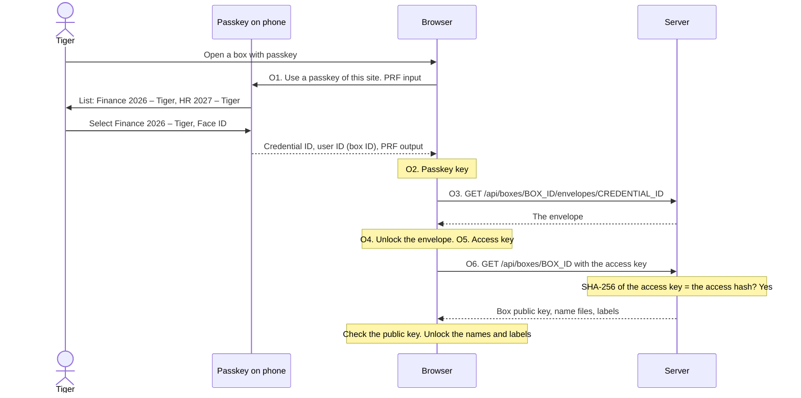
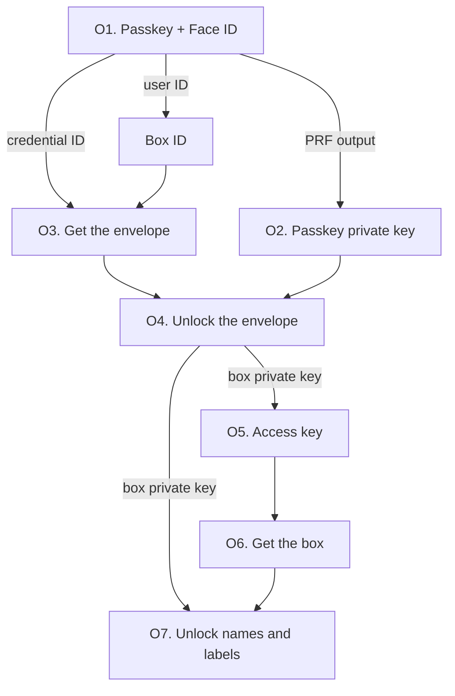

# 2. A member opens a box later

[← All documents](README.md) · [Word list](README.md#the-words-in-these-documents)

## In short

Tiger comes back the next day. He selects **Open a box with passkey**. His phone shows his passkeys, one for each box. He selects "Finance 2026 – Tiger" and uses Face ID. The box opens.

There is no sign-in. The passkey does not talk to the server. It only gives the key that unlocks Tiger's envelope.

## What Tiger sees

1. Open Secretbox.
2. Select **Open a box with passkey**.
3. The phone shows a list: "Finance 2026 – Tiger", "HR 2027 – Tiger". Select "Finance 2026 – Tiger".
4. Confirm with Face ID.
5. The box "Finance 2026" opens on the **Items** tab. The members are on the **People** tab.

## What happens, in plain words

1. The browser asks the phone for a passkey of this site. It sends the same PRF input as before.
2. Tiger selects a passkey and uses Face ID.
3. The passkey gives three things: its credential ID, its user ID and the PRF output. The user ID is the box ID.
4. The browser asks the server for the envelope of this passkey in this box. The server needs no proof for this, because only the passkey can unlock the envelope.
5. The PRF output is the passkey private key. It unlocks the envelope. The browser gets the box private key.
6. The browser calculates the access key from the box private key.
7. With the access key, the browser gets the box from the server. The box private key unlocks the names and labels. The box shows.

## Who talks to whom

## How the keys flow

## Steps: input, method, output

| Step | Input | Method | Output | Goes to |
|---|---|---|---|---|
| O1. Use a passkey | The PRF input `secretbox passkey key v1`. No list of passkeys: the phone shows all passkeys of the site. | WebAuthn `navigator.credentials.get` with the PRF extension. Tiger selects a passkey and uses Face ID. | Credential ID `jnx3yrksw0nZ_pk2v1xPmQ`. User ID `Ze3WdI5DdSbboy05-E6vhQ`. PRF output `102c876b3d31d206…` | O2, O3 |
| O2. Passkey key | The PRF output (O1). | The same as step C4 in [scenario 1](01-create-box.md). | Passkey private key `AGE-SECRET-KEY-1ZQKGW6EAX8…`. It is the same key as in scenario 1, because the passkey and the input are the same. | O4 |
| O3. Get the envelope | The box ID and the credential ID (O1). | `GET /api/boxes/:id/envelopes/:credentialId`. This request needs no access key. | Tiger's envelope, 274 bytes. | O4 |
| O4. Unlock the envelope | The envelope (O3). The passkey private key (O2). | The age recipe backwards: X25519 with the temporary public part `J4i8VohRwgZc7yBo…` gives the shared secret `fc792fcf55a406d4…`. HKDF-SHA-256 gives the wrap key `7893469b188bafd6…`. ChaCha20-Poly1305 unlocks the file key `11de376a…`. Then the header check and the payload. | Box private key `AGE-SECRET-KEY-174SLE9SKAT…` | O5, O7. It stays in tab memory. |
| O5. Access key | The box private key (O4). | HMAC-SHA-256 with the text `secretbox access key v1`, as in step C6. | `w12HnRha1TekeupnN6JmZUsjz5UVc44WckyrUY8nt60`. The same value as in scenario 1. | O6 |
| O6. Get the box | The box ID. The access key (O5). | `GET /api/boxes/:id` with `Authorization: Bearer` and the access key. The server calculates SHA-256 of the key and looks for a box with that ID and that hash. | The box public key, the box name file, the member name files, the item labels and the open invites. | O7 |
| O7. Check and unlock | The answer (O6). The box private key (O4). | The browser calculates the public key from the box private key. It must be the same as the box public key from the server. Then the box private key unlocks each name file and label. | "Finance 2026". The members and the items. | The screen |

**Why the server can give the envelope to anybody.** The envelope opens only with the passkey private key. That key comes from the passkey and Face ID. The server never sees it. A person who copies the envelope cannot unlock it.

**Why the server cannot give a false envelope.** To make an envelope that Tiger's passkey key unlocks, the server needs Tiger's passkey **public** key. The server never gets it. The envelope does not show it either.

**Why the browser checks the public key (O7).** Members lock new data with the box public key from the server. If the server gave a different public key, new data could go to the wrong person. The browser has the box private key, so it can find this. Then it shows an error and adds nothing.

## Lock, reload and close

The box private key and the access key stay in tab memory only. They go away when:

- Tiger selects **Lock**,
- Tiger reloads the page,
- Tiger closes the tab.

Then the box page shows "This box is locked" and **Open with passkey**. One Face ID opens it again.

## If the passkey was removed

A member can remove Tiger. Then the server deletes his envelope. At step O3, the server answers "This passkey does not open this box". Tiger's passkey stays on his phone, but it opens nothing. See [flaw 2](08-security.md#2-removal-deletes-only-the-envelope).

## Result

| Where | What |
|---|---|
| Server | Nothing changes. |
| Browser tab memory | The box private key and the access key, until **Lock**, a reload or a closed tab. |

| Action | Face ID |
|---|---|
| Open a box | 1 |
| Read, add, invite, remove while the box is open | 0 |
| Open the box again after **Lock**, a reload or a closed tab | 1 |

## Technical details

- [Passkey PRF and the passkey list (step O1)](technical/passkey-prf.md)
- [The access key and how the server checks it (steps O5 and O6)](technical/passkeys-and-access-keys.md)
- [API calls and database statements](technical/api-and-sql.md)

[← Previous](01-create-box.md) · [Next: a member adds an item →](03-add-item.md)
