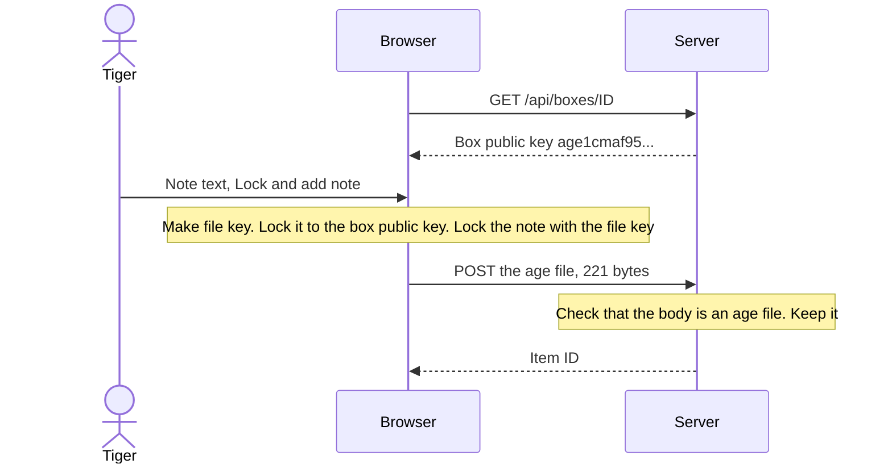
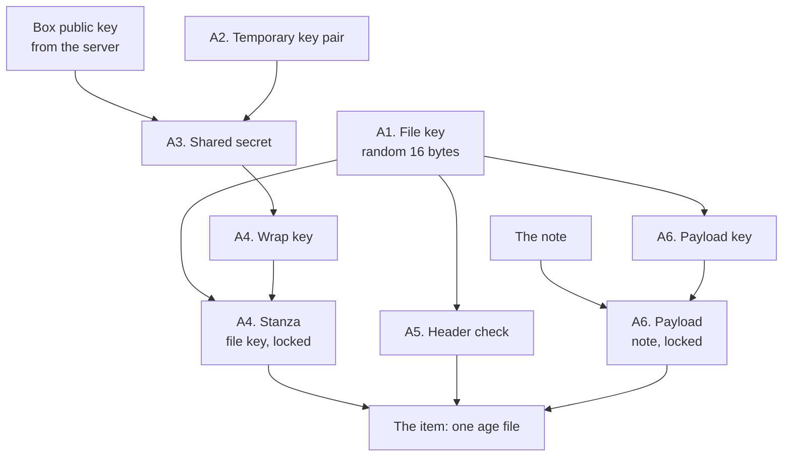
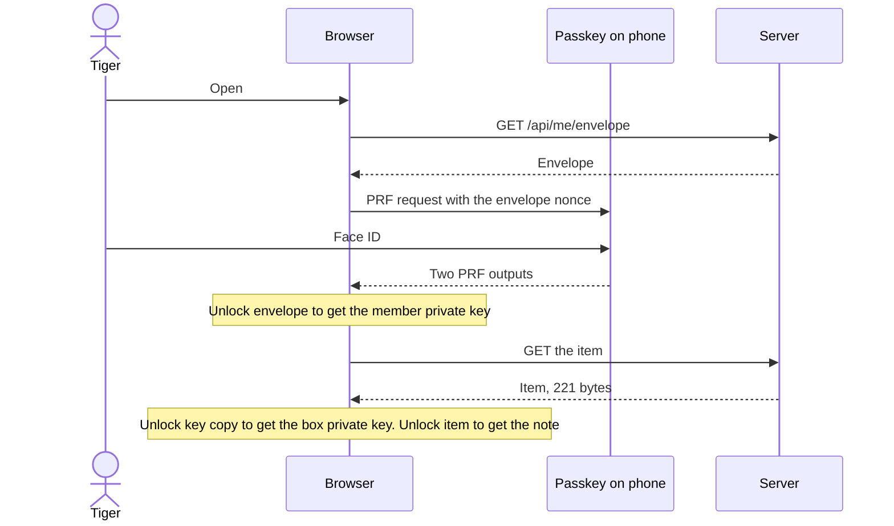
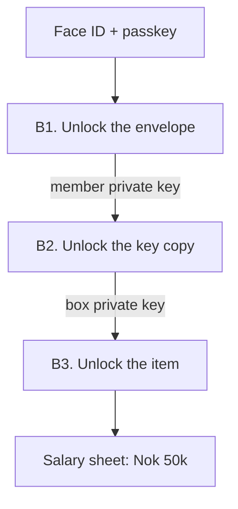

# 3. An admin adds an item, and a member reads it

[← All documents](README.md) · [Word list](README.md#the-words-in-these-documents)

## In short

Tiger adds a note to "Finance 2026": `Salary sheet: Nok 50k`.

**Adding** needs only the box **public** key. The browser locks the note before it sends it. No Face ID is necessary.

**Reading** needs the box **private** key. To get it, the browser unlocks a chain: the envelope, then the key copy, then the item. Only the first step needs Face ID.

## What Tiger sees

To add:

1. Open the box "Finance 2026".
2. Type the note. Select **Lock and add note**.
3. The note shows in the list.

To read:

1. Select **Open** next to the note.
2. If the box is locked, confirm with Face ID.
3. The note shows.

## Part A: add the item

### What happens, in plain words

1. The browser gets the box public key from the server.
2. The browser makes a new random file key for this item.
3. The box public key locks the file key.
4. The file key locks the note.
5. The browser sends the age file. The server keeps it, but cannot open it.

### Who talks to whom



### How the keys flow



### Steps: input, method, output

| Step | Input | Method | Output | Goes to |
|---|---|---|---|---|
| A1. File key | Random bytes. | Random 16 bytes. | `cd1ccd6eaec89e98d4f471bb5df883b1` | A4, A5, A6 |
| A2. Temporary key pair | Random bytes. | X25519 key generation. | Temporary public part `/pqZPOaW72Agg6Fl…` | A3, and the stanza line |
| A3. Shared secret | The temporary private part (A2). The box public key `age1cmaf95n0vkusfv0s…`. | X25519 | `23d90d44fd1301f3…` | A4 |
| A4. Lock the file key | The shared secret (A3). The file key (A1). | HKDF-SHA-256 makes the wrap key `6a4b5f84fc12fa7e…`. ChaCha20-Poly1305 locks the file key. | Stanza body `PCuJa75fjmrNPWOP…` | The header |
| A5. Header check | The file key (A1). The header. | HKDF-SHA-256 makes the MAC key `3462dbdb5bdcbccf…`. HMAC-SHA-256 makes the MAC. | MAC `d9K/j0cZ5BhNZu2C…` | The header |
| A6. Payload | The file key (A1). The note (21 bytes). | HKDF-SHA-256 with a random nonce `035cb87a3110c494…` makes the payload key `af0713c5109785be…`. ChaCha20-Poly1305 locks the note. | 53 bytes: a 16-byte nonce, 21 locked bytes, a 16-byte tag. | The item |
| A7. Send | The item (221 bytes). | `POST /api/boxes/:id/items?name=note.txt` | The server checks that the body starts with `age-encryption.org/v1`, then keeps it. | Part B |

The item, as the server keeps it:

```
age-encryption.org/v1
-> X25519 /pqZPOaW72Agg6FlpqZc55RhqNRVcUIb5HTZWni73k8
PCuJa75fjmrNPWOPyy3VF7Ax1WEYf/4Rnz4O5y3LUwY
--- d9K/j0cZ5BhNZu2CDKp+oWbsjo5/KmHEBwjpCGPae8A
[53 bytes: the note, locked]
```

### The keys in this part

| Key | Secret? | Where it comes from | What it does here |
|---|---|---|---|
| Box public key | No | The server | Locks the file key (A3, A4). |
| Temporary key pair | Yes, but only for a moment | Made in A2 | Makes the shared secret. The browser then forgets the private part. |
| File key | Yes | Made in A1 | Locks the note, through the payload key. |
| Member key | Not used | | Adding does not need it. |
| Passkey | Not used | | Adding does not need Face ID. |

### Another system adds an item

A form tool or a script can add items too. It uses the box public key and an **ingest token**. It cannot read items, because it has no private key.

```
age -r age1cmaf95n0vkusfv0st6wyqgmqtqknwewmn0p0c8el9n9t30lltsss24fc3d answer.txt \
  | curl --data-binary @- -H "Authorization: Bearer sbx_…" \
    "https://secretbox-nu.vercel.app/api/ingest/BOX_ID?name=answer.txt"
```

The age command does steps A1 to A6. The result is the same kind of age file.

## Part B: read the item

### What happens, in plain words

1. Face ID unlocks Tiger's envelope. The browser gets his member private key.
2. The member private key unlocks his key copy. The browser gets the box private key.
3. The box private key unlocks the item. The browser shows the note.

### Who talks to whom



The browser gets the key copy earlier, when it loads the box page.

### How the keys flow



### Steps: input, method, output

Each unlock does the age recipe backwards. The values are the same values that the lock steps made.

| Step | Input | Method | Output | Goes to |
|---|---|---|---|---|
| B1. Unlock the envelope | The envelope. Face ID. The nonce `rz/XB5+tax7mwcIJowbCPQ` from its stanza. | PRF gives the same outputs `add6282257e13a4c…` and `752b4f4795cd974d…`. HKDF-SHA-256 gives the wrap key `7b1ee88fcb85256e…`. ChaCha20-Poly1305 unlocks the file key `bd991a3d…`. Then the header check and the payload. | Member private key `AGE-SECRET-KEY-1XZZ8PLLYDCJ…` | B2. It also stays in tab memory. |
| B2. Unlock the key copy | Tiger's key copy. The member private key (B1). | X25519 with the temporary public part `qj0vsVPNwwInsjLR…` gives the same shared secret `069cfb215096db27…`. HKDF-SHA-256 gives the wrap key. ChaCha20-Poly1305 unlocks the file key `9aa2522d…`. Then the payload. | Box private key `AGE-SECRET-KEY-1TECYTY27F3E…` | B3 |
| B3. Unlock the item | The item. The box private key (B2). | X25519 with `/pqZPOaW72Agg6Fl…` gives the same shared secret `23d90d44fd1301f3…`. HKDF-SHA-256 gives the wrap key `6a4b5f84…`. ChaCha20-Poly1305 unlocks the file key `cd1ccd6e…`. The payload key `af0713c5…` unlocks the payload. | `Salary sheet: Nok 50k` | The screen |

**Why the shared secret is the same in A3 and B3.** X25519 gives one value from two different pairs:

- the temporary private part and the box public key (when Tiger locks),
- the box private key and the temporary public part (when a member unlocks).

Only a person who has one of the two private parts can calculate the value.

**Old box keys.** If an admin changed the box key, older items are locked to an older box key. B2 then also unlocks the **key history**, which holds the old box private keys. B3 tries each key until one fits.

**Face ID count to read:**

| Situation | Face ID |
|---|---|
| The first item after the page loads | 1 |
| Each item after that | 0 |
| After a reload, a closed tab or **Lock** | 1 again |

## Result

| Where | What |
|---|---|
| Server | The item (an age file). The item name, its size, who added it and when. The name is not locked. |
| Browser tab memory | While reading: the member private key, the box private key and the note. |

## Technical details

- [The X25519 stanza, header check and payload, step by step](technical/age-format.md)
- [The fido2prf stanza (step B1)](technical/passkey-prf.md)
- [API calls and database statements](technical/api-and-sql.md)

[← Previous](02-existing-user-new-box.md) · [Next: an admin makes an invite link →](04-create-invite.md)
