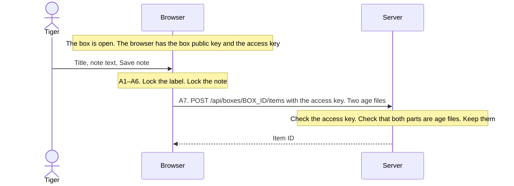
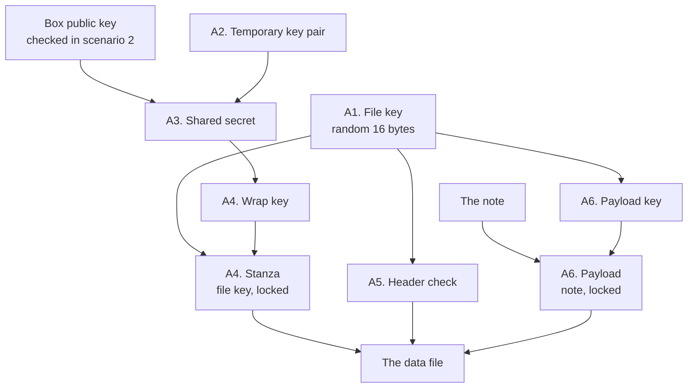
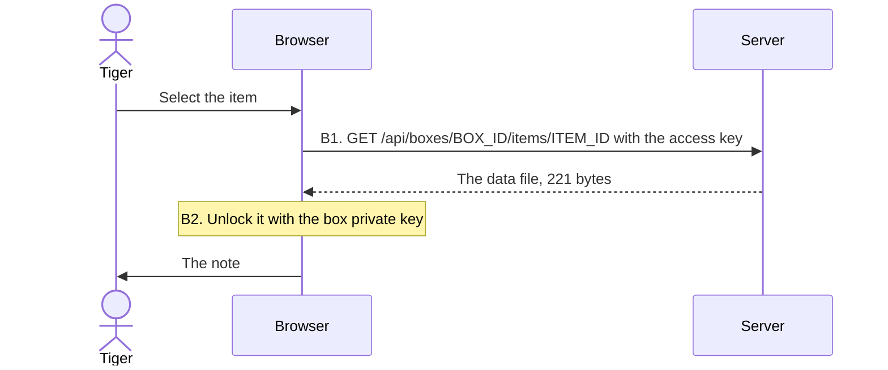

# 3. A member adds an item, and a member reads it

[← All documents](README.md) · [Word list](README.md#the-words-in-these-documents)

## In short

Tiger adds a note to "Finance 2026": `Salary sheet: Nok 50k`.

**Adding** needs only the box **public** key. The browser locks the note and its name before it sends them. The server keeps two age files: the **label** and the **data**.

**Reading** needs the box **private** key. When the box is open, the browser has it in memory. So reading needs no Face ID.

## What Tiger sees

To add:

1. Open the box "Finance 2026". The **Items** tab shows.
2. Select **New note**. Type a title and the note. Select **Save note**.
3. The note shows in the list, with its title, size, "you" and the date. Other members see "the box creator" in place of "you".

To add a file, select **Upload file** and choose the file. The upload starts immediately.

To read:

1. Select the note in the list.
2. The note shows below its title.

## Part A: add the item

### What happens, in plain words

1. The browser makes the label: the name `note.txt`, the type, the size and Tiger's name in the box. That name is empty, because nobody named the box creator.
2. The browser locks the label with the box public key.
3. The browser locks the note with the box public key. Each lock makes a new random file key.
4. The browser sends the two age files with the access key. The server keeps them, but cannot open them.

### Who talks to whom



### How the keys flow

The browser does the same recipe two times: for the label and for the note. This diagram shows the note.



### Steps: input, method, output

| Step | Input | Method | Output | Goes to |
|---|---|---|---|---|
| A0. Label | The name, the type, the size and Tiger's name in the box (empty). | JSON text. | `{"name":"note.txt","type":"text/plain","size":21,"addedBy":""}` | The same recipe as A1–A6. The result is the label file, 262 bytes. Then A7. |
| A1. File key | Random bytes. | Random 16 bytes. | `181d2143f6842c5f890af24f31f82511` | A4, A5, A6 |
| A2. Temporary key pair | Random bytes. | X25519 key generation. | Temporary public part `AD54KjOicKeazfzd…` | A3, and the stanza line |
| A3. Shared secret | The temporary private part (A2). The box public key `age13aa297n0wgzsleu3…`. | X25519 | `af7cc562dd4215b2…` | A4 |
| A4. Lock the file key | The shared secret (A3). The file key (A1). | HKDF-SHA-256 makes the wrap key `727033c3be92eef8…`. ChaCha20-Poly1305 locks the file key. | Stanza body `KtdBzgL4Er4NWxoo…` | The header |
| A5. Header check | The file key (A1). The header. | HKDF-SHA-256 makes the MAC key `64fe47e035af8b17…`. HMAC-SHA-256 makes the MAC. | MAC `Ybz7E174I61mgtDz…` | The header |
| A6. Payload | The file key (A1). The note (21 bytes). | HKDF-SHA-256 with a random nonce `f00dc556ab7e9a0b…` makes the payload key `1b14184454168d49…`. ChaCha20-Poly1305 locks the note. | 53 bytes: a 16-byte nonce, 21 locked bytes, a 16-byte tag. | The data file |
| A7. Send | The label file (A0) and the data file (221 bytes). The access key. | `POST /api/boxes/:id/items`, as two parts of a form: `label` and `data`. | The server checks the access key. It checks that each part starts with `age-encryption.org/v1`. Then it keeps them. | Part B |

The data file, as the server keeps it:

```
age-encryption.org/v1
-> X25519 AD54KjOicKeazfzd1FA/xo8LMpW2jYkZxPPY2m+GUR8
KtdBzgL4Er4NWxoo845H/GYvQNx4h8YnB49HlcF46/Y
--- Ybz7E174I61mgtDzKu/w9B401BHoANVNRqlKya28DWQ
[53 bytes: the note, locked]
```

The label file looks the same, with different values. The server cannot see the name `note.txt`.

### The keys in this part

| Key | Secret? | Where it comes from | What it does here |
|---|---|---|---|
| Box public key | No | The server. The browser checked it against the box private key. | Locks the two file keys (A3, A4). |
| Temporary key pair | Yes, but only for a moment | Made in A2 | Makes the shared secret. The browser then forgets the private part. |
| File key | Yes | Made in A1 | Locks the note, through the payload key. |
| Access key | Yes | Calculated when the box opened | Shows the server that a member sends the item. |
| Passkey | Not used | | Adding needs no Face ID. |

### Another system adds an item

A form tool or a script can add items too. A member makes an **add key** for it on the **Integration** tab of the box. The server keeps only the SHA-256 hash of the add key, for example `2e8700659d1ccec3…`.

The other system needs the box public key and the add key. It cannot read, list or delete items, because it has no private key and no access key.

```
age -r age13aa297n0wgzsleu3hhsptlpjajl6a4cwyvhy3fzplhgfk0hsauqqlklqjx answer.txt \
  | curl --data-binary @- -H "Authorization: Bearer vlt_…" \
    "https://vlt.i7r.tech/api/ingest/nbtYKFvPJE6MnspnIVuu4Q"
```

The age command does steps A1 to A6. It sends only the data file, with no label. So the members see the item as "From an outside system". A member can make a new add key. Then the old add key stops working.

## Part B: read the item

### What happens, in plain words

1. The browser gets the data file from the server. It sends the access key.
2. The box private key unlocks the data file. The browser shows the note.

The browser unlocked the label before, when it showed the list.

### Who talks to whom



### Steps: input, method, output

| Step | Input | Method | Output | Goes to |
|---|---|---|---|---|
| B1. Get the data file | The item ID. The access key. | `GET /api/boxes/:id/items/:itemId` | The data file, 221 bytes. | B2 |
| B2. Unlock | The data file (B1). The box private key, from tab memory. | X25519 with the temporary public part `AD54KjOicKeazfzd…` gives the same shared secret `af7cc562dd4215b2…`. HKDF-SHA-256 gives the wrap key `7abc12d3…`. ChaCha20-Poly1305 unlocks the file key `181d2143…`. The payload key `1b141844…` unlocks the payload. | `Salary sheet: Nok 50k` | The screen |

**Why the shared secret is the same in A3 and B2.** X25519 gives one value from two different pairs:

- the temporary private part and the box public key (when Tiger locks),
- the box private key and the temporary public part (when a member unlocks).

Only a person who has one of the two private parts can calculate the value.

## Result

| Where | What |
|---|---|
| Server | The label file and the data file. The date. The size of each file. |
| Browser tab memory | While reading: the box private key and the note. |

| Action | Face ID |
|---|---|
| Add an item (box open) | 0 |
| Read an item (box open) | 0 |
| A locked box | 1 to open it first ([scenario 2](02-open-box.md)) |

## Technical details

- [The X25519 stanza, header check and payload, step by step](technical/age-format.md)
- [The add key](technical/passkeys-and-access-keys.md#the-add-key)
- [API calls and database statements](technical/api-and-sql.md)

[← Previous](02-open-box.md) · [Next: a member makes an invite link →](04-create-invite.md)
