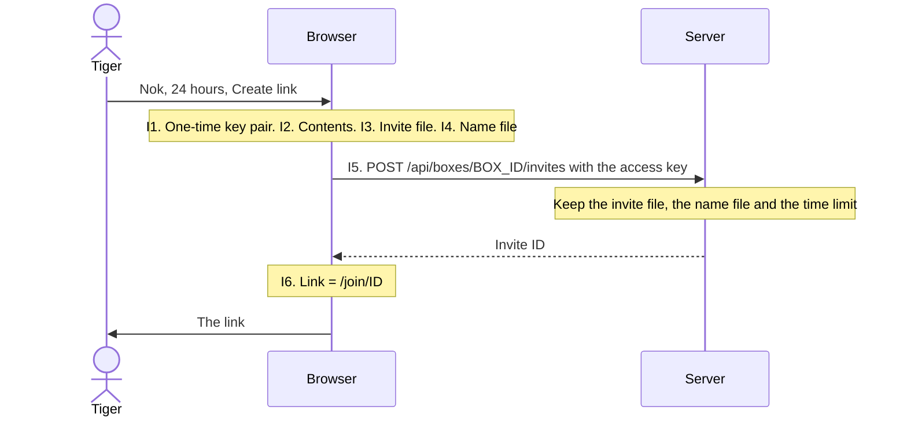
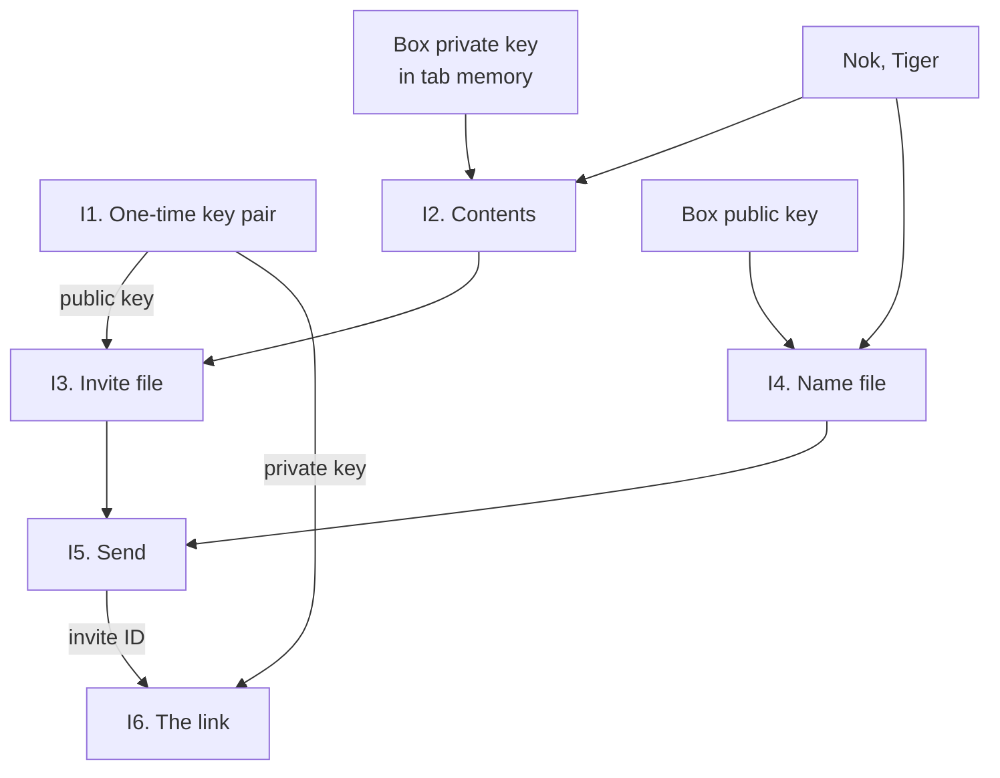

# 4. A member makes an invite link

[← All documents](README.md) · [Word list](README.md#the-words-in-these-documents)

## In short

Tiger invites Nok to "Finance 2026". He types her name, "Nok". The browser puts a copy of the box private key in an **invite file**, and locks it with a new **one-time key**. The one-time private key goes into the link, after the `#` sign. The server gets the invite file, but never the `#` part.

Any member can make an invite link. When the box is open, this needs no Face ID.

## What Tiger sees

1. In the box, select the **People** tab.
2. Under **Invite someone**, type "Nok". The link works for 24 hours. To change this, select **Change**.
3. Select **Create link**.
4. Select **Copy link**, or **Share** on a phone. Send the link to Nok in a private chat.
5. "Nok" shows under **Waiting to be used**, with **Cancel**.

## What happens, in plain words

1. The browser makes a new key pair: the **one-time key**.
2. The browser writes the invite contents: the box private key, the name "Nok" and the name "Tiger".
3. The one-time public key locks the contents. The result is the **invite file**.
4. The box public key locks the two names again. The result is a **name file** for the list of open invites.
5. The browser sends the invite file and the name file. The server gives back an invite ID.
6. The browser writes the link: the invite ID, then `#`, then the one-time private key.

## Who talks to whom



## How the keys flow



## Steps: input, method, output

| Step | Input | Method | Output | Goes to |
|---|---|---|---|---|
| I1. One-time key pair | Random bytes. | X25519 key generation. | Private key `AGE-SECRET-KEY-1VVSKC8UZAP…`. Public key `age1mvvn8w0ups0hkpmv…` | I3 (public key), I6 (private key) |
| I2. Contents | The box private key, from tab memory. The name "Nok". Tiger's name, from his name file. | JSON text. | `{"boxKey":"AGE-SECRET-KEY-174SLE9SKAT…","name":"Nok","invitedBy":"Tiger"}` (120 bytes) | I3 |
| I3. Invite file | The contents (I2). The one-time public key (I1). | The age recipe with an X25519 stanza: file key `c3cc0604…`, temporary public part `faFw4MuKvrNGVQkq…`, shared secret `ef61dca8ede5eaa3…`, wrap key `ff17ff798f4a8445…`. | The invite file, 320 bytes. | I5 |
| I4. Name file | The text `{"name":"Nok","invitedBy":"Tiger"}`. The box public key. | The age recipe with an X25519 stanza. | The name file, 234 bytes. | I5 |
| I5. Send | The invite file (I3). The name file (I4). The time limit. The access key. | `POST /api/boxes/:id/invites` | The server keeps one row. It gives back the invite ID `iFhx-052UgwYFJqH7AhiuA`. | I6 |
| I6. The link | The site address. The invite ID (I5). The one-time private key (I1). | Join them: `/join/` + ID + `#` + private key. | The link (below). | Tiger sends it to Nok. [Scenario 5](05-use-invite.md) |

The link:

```
https://secretbox-nu.vercel.app/join/iFhx-052UgwYFJqH7AhiuA#AGE-SECRET-KEY-1VVSKC8UZAPXKYZ9SXCY36SA0TGHXMNJ52MT7MCLD78ZHTLG7DSASWLV44L
```

| Part of the link | What it is | Does the server get it? |
|---|---|---|
| `https://secretbox-nu.vercel.app/join/` | The join page. | Yes |
| `iFhx-052UgwYFJqH7AhiuA` | The invite ID. It finds the row in the database. | Yes |
| `#` | The start of the "fragment". | No |
| `AGE-SECRET-KEY-1VVSKC8UZAP…` | The one-time private key. It unlocks the invite file. | **No.** Browsers never send the part after `#`. |

The invite file, as the server keeps it:

```
age-encryption.org/v1
-> X25519 faFw4MuKvrNGVQkqm+uAR2amQ/RHLDbBidrgm515uU4
HLi84QWv0c9SIDNFL4e9WNVVBjClKgvktmK1YUIM3sI
--- lqY5eLGfaa8npm24WxxYuiBlRYBMRkMVndsvJbWcxiU
[152 bytes: the box private key and two names, locked]
```

**Why two parts.** The server has the invite file, but not the key. The link has the key, but not the invite file. A person needs both parts to get the box private key.

**Why the browser forgets the one-time private key.** The link is the only copy. Tiger's browser shows the link one time. The browser cannot show a lost link again. Tiger then makes a new link.

## Cancel an invite

Under **Waiting to be used**, any member can select **Cancel**. The server deletes the row, with the invite file. The link then opens nothing.

## Time limit

The member selects 1 hour, 24 hours, 3 days or 7 days. The server stops the claim after this time. It deletes the expired rows when somebody makes or opens an invite. See [scenario 6](06-invite-expired-or-reused.md).

## Result

| Where | What |
|---|---|
| Server | One row: the invite ID, the box ID, the invite file, the name file and the time limit. |
| The link (in Tiger's chat with Nok) | The invite ID and the one-time private key. |
| Tiger's browser | Nothing. It forgets the one-time private key. |

| Action | Face ID |
|---|---|
| Make an invite link (box open) | 0 |

## Technical details

- [The X25519 stanza, step by step (step I3)](technical/age-format.md)
- [API calls and database statements (step I5)](technical/api-and-sql.md)

[← Previous](03-add-item.md) · [Next: a person uses an invite link →](05-use-invite.md)
