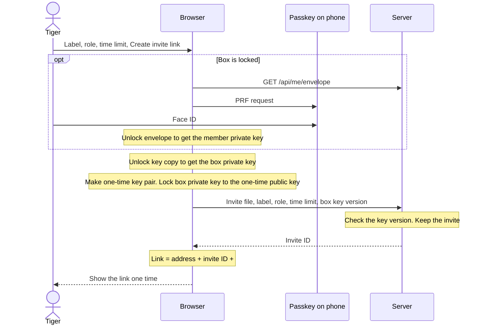
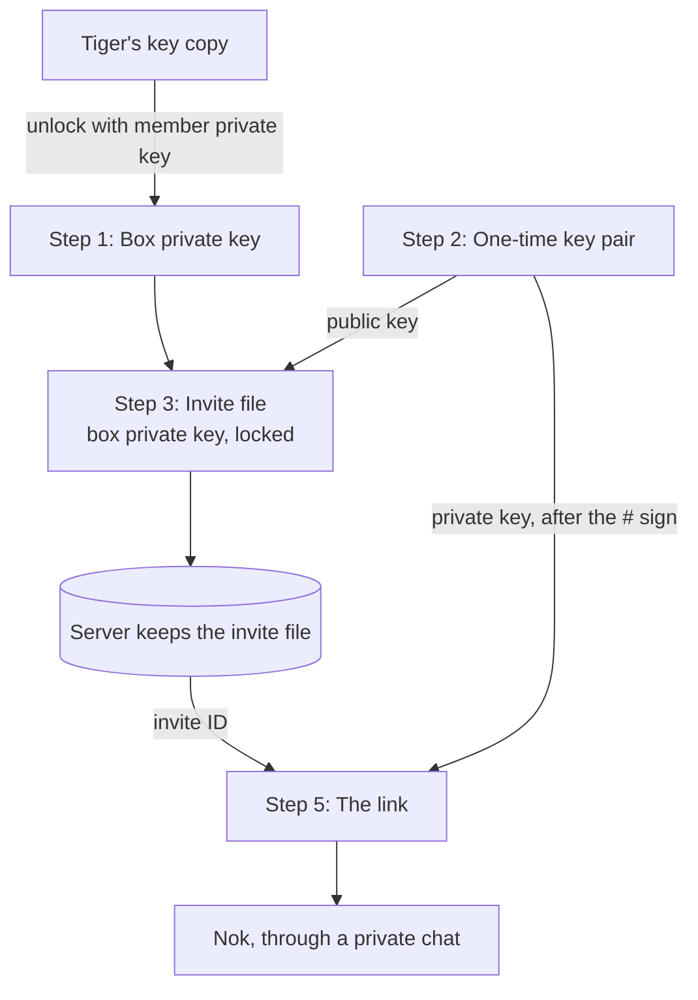

# 4. An admin makes an invite link

[← All documents](README.md) · [Word list](README.md#the-words-in-these-documents)

## In short

Tiger wants Nok to read "Finance 2026". He makes an invite link and sends it to her in a private chat.

The link holds a **one-time private key** after the `#` sign. The server holds an **invite file**: a copy of the box private key, locked to the matching one-time public key. The link and the invite file are useless alone. Together, they give the box private key.

Browsers never send the part after `#` to a server. So the server never gets the one-time private key.

## What Tiger sees

1. Open the box "Finance 2026".
2. Under **Invite someone**, type who the invite is for ("Nok, finance").
3. Select the role (**Reader**) and the time limit (**24 hours**).
4. Select **Create invite link**.
5. If the box is locked, confirm with Face ID.
6. Copy the link. Send it to Nok in a private chat.

> **CAUTION:** The app shows the link one time only. The server cannot show it again, because it does not have the one-time private key.

## What happens, in plain words

1. The browser gets the box private key. It unlocks Tiger's envelope (Face ID, if locked) and then his key copy.
2. The browser makes a one-time key pair.
3. The one-time public key locks a copy of the box private key. The result is the **invite file**.
4. The server keeps the invite file, the label, the role and the time limit. It gives back an invite ID.
5. The browser puts the invite ID and the one-time private key in the link.

## Who talks to whom



## How the keys flow



## Steps: input, method, output

| Step | Input | Method | Output | Goes to |
|---|---|---|---|---|
| 1. Get the box private key | Tiger's envelope and key copy. Face ID, if the box is locked. | Unlock the envelope ([scenario 3, step B1](03-add-item.md#steps-input-method-output-1)). Then unlock the key copy (step B2). | Box private key `AGE-SECRET-KEY-1TECYTY27F3E…` | Step 3 |
| 2. Make the one-time key | Random bytes. | X25519 key generation. | One-time private key `AGE-SECRET-KEY-1ZQYRVJWHT7S…`. One-time public key `age1zmqagtd3ryrvzkfa…`. | Public key → step 3. Private key → step 5. |
| 3. Lock the box private key | The box private key (step 1). The one-time public key (step 2). | age file with an **X25519** stanza. | The **invite file**, 274 bytes. | Step 4 |
| 4. Keep the invite | The invite file. Label "Nok, finance". Role "reader". Time limit 24 hours. Box key version 1. | `POST /api/boxes/:id/invites`. The server checks that the box key did not change. | An invite row. Invite ID `n2Wct0b4C-ivqkLH2pCjjw`. | Step 5 |
| 5. Make the link | The page address. The invite ID (step 4). The one-time private key (step 2). | Join them in the browser. | The link. | Nok ([scenario 5](05-use-invite.md)) |

### Inside step 3: how the invite file is made

| Part | Input | Method | Output | Goes to |
|---|---|---|---|---|
| 3a. File key | Random bytes. | Random 16 bytes. | `dce16d58369b23978d4df0bb59a291d8` | 3d, 3e, 3f |
| 3b. Temporary key pair | Random bytes. | X25519 key generation. | Temporary public part `Nr8nxPrNXwfWTjIF…` | 3c, and the stanza line |
| 3c. Shared secret | The temporary private part (3b). The one-time public key (step 2). | X25519 | `0d84a593c8403ce1…` | 3d |
| 3d. Lock the file key | The shared secret (3c). The file key (3a). | HKDF-SHA-256 makes the wrap key `bad765bb4383f10d…`. ChaCha20-Poly1305 locks the file key. | Stanza body `43i8p4xeE2bsFIu9…` | The header |
| 3e. Header check | The file key (3a). The header. | HKDF-SHA-256, then HMAC-SHA-256. | MAC `J11kxlFWjKXPzd+d…` | The header |
| 3f. Payload | The file key (3a). The box private key (step 1). | HKDF-SHA-256 makes the payload key `61e6dd1c68e05eee…`. ChaCha20-Poly1305 locks the data. | 106 bytes | The invite file |

The invite file, as the server keeps it:

```
age-encryption.org/v1
-> X25519 Nr8nxPrNXwfWTjIF4FtZPONWr5scfYGBeqLWFvFbJQ4
43i8p4xeE2bsFIu9u/WRucCJgo2E1hu6leKSJW0r4Zc
--- J11kxlFWjKXPzd+dZpHI64khITa4nJROdNy2EPICA08
[106 bytes: the box private key, locked]
```

## The link

```
https://secretbox-nu.vercel.app/join/n2Wct0b4C-ivqkLH2pCjjw#AGE-SECRET-KEY-1ZQYRVJWHT7SCSLNGVXUGYQL25EVPVJ7FFVMMTLRD3290EY6GEQFQVZG20P
```

| Part | Example | Who sees it |
|---|---|---|
| Address | `https://secretbox-nu.vercel.app` | Everybody |
| Path with the invite ID | `/join/n2Wct0b4C-ivqkLH2pCjjw` | The browser sends it to the server. |
| Fragment with the one-time private key | `#AGE-SECRET-KEY-1ZQYRVJWHT7S…` | Only the browser. Browsers do not send the part after `#`. |

## Why the box key version matters

The invite file holds the **current** box private key. If an admin changes the box key at the same moment, the invite file is old and useless. The server prevents this:

- The browser sends the box key version that it used (here, 1).
- The server reads the box row with a shared lock (`FOR SHARE`). It compares the version.
- If the version changed, the server refuses the invite. The browser must reload.
- When an admin changes the box key later, the server cancels all open invites.

## Result

| Where | What |
|---|---|
| Server | The invite row: the invite file, the label, the role, the time limit, who made it. |
| The link (in Tiger's chat with Nok) | The invite ID and the one-time private key. |
| Nowhere else | The one-time private key. The server and the database never get it. |

**Face ID count:** 0 if the box is unlocked. 1 if it is locked.

## Technical details

- [The X25519 stanza, header check and payload](technical/age-format.md)
- [API calls and database statements](technical/api-and-sql.md)

[← Previous](03-add-item.md) · [Next: a person uses an invite link →](05-use-invite.md)
