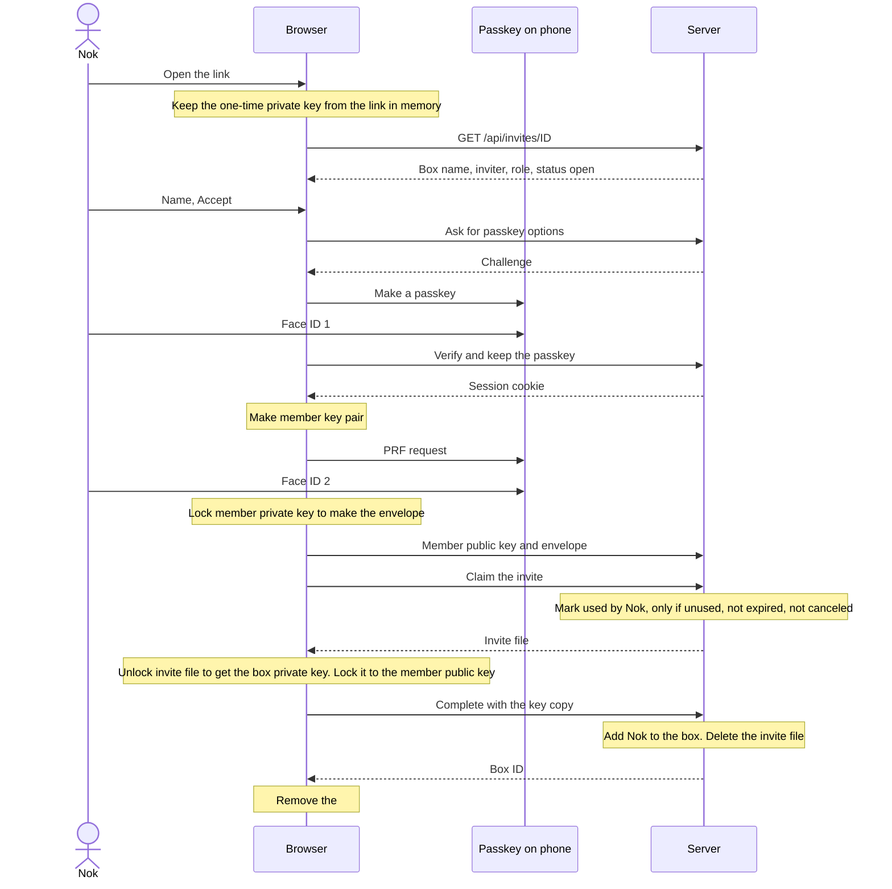
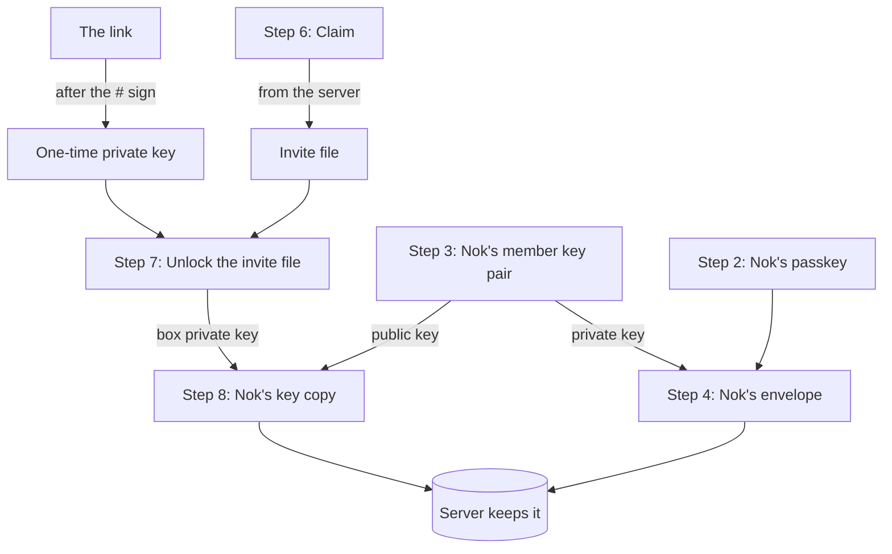

# 5. A person uses an invite link

[← All documents](README.md) · [Word list](README.md#the-words-in-these-documents)

## In short

Nok opens Tiger's link. She types her name and selects **Accept**. Her phone asks for Face ID two times. Then she sees the box.

During these steps:

1. Nok gets a passkey and a member key, as Tiger did in [scenario 1](01-new-user-new-box.md).
2. The server gives the invite file to Nok, **one time only**.
3. The one-time private key from the link unlocks the invite file. Nok's browser gets the box private key.
4. Nok's member public key locks the box private key. The result is Nok's own key copy.
5. The server deletes the invite file. The link is now useless.

## What Nok sees

1. Open the link from the chat.
2. The page shows: "Tiger invited you to read 'Finance 2026'."
3. Type a name ("Nok"). Select **Accept and make passkey**.
4. Confirm with Face ID. The phone makes a passkey.
5. Confirm with Face ID again. The phone locks her member key.
6. The box opens. The address bar does not show the `#` part any more.

## What happens, in plain words

1. The page loads. The browser keeps the one-time private key from the link in memory. The server changes nothing.
2. The phone makes Nok's passkey. The server signs her in.
3. The browser makes Nok's member key pair. The passkey locks the private key into her envelope.
4. The server marks the invite as used by Nok. It gives her the invite file.
5. The one-time private key unlocks the invite file. The browser gets the box private key.
6. Nok's member public key locks the box private key. The result is her key copy.
7. The server keeps the key copy and adds Nok to the box. It deletes the invite file.
8. The browser removes the `#` part from the address bar.

## Who talks to whom



## How the keys flow



## Steps: input, method, output

| Step | Input | Method | Output | Goes to |
|---|---|---|---|---|
| 1. Open the link | The link. | The browser reads the part after `#`. `GET /api/invites/n2Wct0b4C-ivqkLH2pCjjw` gives the status. | The one-time private key `AGE-SECRET-KEY-1ZQYRVJWHT7S…`, in memory. Status "open". | Step 7 |
| 2. Make the passkey and sign in | A challenge from the server. Face ID 1. | WebAuthn registration, as in [scenario 1](01-new-user-new-box.md). | Nok's passkey, credential ID `ja_SNBMxGp7ZfADxslkScA`. A session cookie. | Steps 4 and 6 |
| 3. Make the member key | Random bytes. | X25519 key generation. | Private key `AGE-SECRET-KEY-13YSGDVJWX2U…`. Public key `age13xxmju0leg22w5x4…`. | Private key → step 4. Public key → steps 5 and 8. |
| 4. Lock the member private key | The member private key (step 3). The passkey (step 2). Face ID 2. | age file with a **fido2prf** stanza. | Nok's **envelope**, 274 bytes. | Step 5 |
| 5. Keep the member key | The member public key (step 3). The envelope (step 4). | `PUT /api/me/keys` | The server keeps both. | Later unlocks |
| 6. Claim the invite | The invite ID. The session cookie. | `POST /api/invites/:id/claim`. One database statement marks the invite "used by Nok". | The invite file (274 bytes). | Step 7 |
| 7. Unlock the invite file | The invite file (step 6). The one-time private key (step 1). | age with an **X25519** stanza, backwards. | Box private key `AGE-SECRET-KEY-1TECYTY27F3E…` | Step 8 |
| 8. Lock the box private key | The box private key (step 7). Nok's member public key (step 3). | age file with an **X25519** stanza. | Nok's **key copy**, 274 bytes. | Step 9 |
| 9. Complete | The key copy (step 8). | `POST /api/invites/:id/complete`. One database transaction. | Nok's membership row. The server deletes the invite file. | The box |
| 10. Clean the address | The address bar. | `history.replaceState` | The address becomes `/box/<id>`. The one-time private key is not in the address bar or in the Back button. | |

### Inside step 4: Nok's envelope

| Part | Input | Method | Output |
|---|---|---|---|
| 4a. File key | Random bytes. | Random 16 bytes. | `deba5664ce6ab82dafcea21936df29cf` |
| 4b. Nonce | Random bytes. | Random 16 bytes. | `70BmpOE5+/6cjjpWWZKN6g` |
| 4c. PRF outputs | The nonce (4b). Face ID. The hidden secret of Nok's passkey. | PRF: HMAC-SHA-256 inside the phone, two times. | `de62a938486ee2cd…` and `bb0924ac2891d9a0…` |
| 4d. Lock the file key | The PRF outputs (4c). The file key (4a). | HKDF-SHA-256 makes the wrap key `b2c1d21b979a7080…`. ChaCha20-Poly1305 locks the file key. | Stanza body `29QyrNlox2cK8G6R…` |
| 4e. Header check | The file key (4a). The header. | HKDF-SHA-256, then HMAC-SHA-256. | MAC `C+S4u5zgk+Hbu1AT…` |
| 4f. Payload | The file key (4a). Nok's member private key. | HKDF-SHA-256 makes the payload key. ChaCha20-Poly1305 locks the data. | 106 bytes |

Nok's passkey has a different hidden secret from Tiger's passkey. So her PRF outputs are different, although the method is the same.

### Inside step 7: unlock the invite file

The browser does the age recipe backwards. It calculates the same values that Tiger's browser made in [scenario 4, step 3](04-create-invite.md#inside-step-3-how-the-invite-file-is-made).

| Part | Input | Method | Output | Goes to |
|---|---|---|---|---|
| 7a. Shared secret | The one-time private key (step 1). The temporary public part `Nr8nxPrNXwfWTjIF…` from the stanza. | X25519 | `0d84a593c8403ce1…`, the same value as in scenario 4 | 7b |
| 7b. Unlock the file key | The shared secret (7a). The stanza body `43i8p4xeE2bsFIu9…`. | HKDF-SHA-256 makes the wrap key `bad765bb4383f10d…`. ChaCha20-Poly1305 unlocks. | File key `dce16d58369b23978d4df0bb59a291d8` | 7c, 7d |
| 7c. Header check | The file key (7b). The header. | HKDF-SHA-256, then HMAC-SHA-256. The result must be `J11kxlFWjKXPzd+d…`. | Pass or fail | |
| 7d. Payload | The file key (7b). The payload. | HKDF-SHA-256 makes the payload key `61e6dd1c68e05eee…`. ChaCha20-Poly1305 unlocks. | Box private key `AGE-SECRET-KEY-1TECYTY27F3E…` | Step 8 |

### Inside step 8: Nok's key copy

| Part | Input | Method | Output |
|---|---|---|---|
| 8a. File key | Random bytes. | Random 16 bytes. | `6f5e5f36cf76ae0886882691aef84469` |
| 8b. Temporary key pair | Random bytes. | X25519 key generation. | Temporary public part `c4myXT0GQgtXlaGE…` |
| 8c. Shared secret | The temporary private part (8b). Nok's member public key. | X25519 | `3d69c59ab0b53fd0…` |
| 8d. Lock the file key | The shared secret (8c). The file key (8a). | HKDF-SHA-256 makes the wrap key `12eb8365f415fc76…`. ChaCha20-Poly1305 locks the file key. | Stanza body `4rTNFsOY0tgYLHGL…` |
| 8e. Header check | The file key (8a). The header. | HKDF-SHA-256, then HMAC-SHA-256. | MAC `4muuH0SkPHX8wkrE…` |
| 8f. Payload | The file key (8a). The box private key (step 7). | HKDF-SHA-256 makes the payload key `308811f7e5675453…`. ChaCha20-Poly1305 locks the data. | 106 bytes |

Tiger and Nok now have different key copies. Both copies hold the same box private key.

## Why one link works only one time

The server allows one claim only. Step 6 is one database statement:

```sql
UPDATE invites SET used_by = 'Nok', used_at = now
WHERE id = 'n2Wct0b4C-ivqkLH2pCjjw'
  AND used_by IS NULL AND canceled_at IS NULL
  AND invite_file IS NOT NULL AND expires_at > now
```

If two people select **Accept** at the same moment, the database changes the row for one of them only. The other person gets "This invite was already used".

Step 9 deletes the invite file. After that, the one-time private key has nothing to unlock. See [scenario 6](06-invite-expired-or-reused.md).

## Other cases

| Case | What changes |
|---|---|
| Nok already has an account and is signed in | Steps 2 to 5 do not occur. The page shows **Accept as Nok**. Face ID count: 0. The key copy needs only her member public key. |
| Nok has an account but is signed out | She selects **I already have a passkey**. Sign-in takes 1 Face ID. Then steps 6 to 10. |
| Nok is already a member of the box | The server refuses step 6 before it marks the invite. The invite stays unused. |
| Opening the page only, or a chat app makes a link preview | Nothing changes. Only **Accept** starts step 6. |

## Result

| Where | What |
|---|---|
| Server | Nok's user row, passkey row, member public key, envelope, key copy and membership. The invite row is "completed". The server deleted its invite file. |
| Browser tab memory | Nok's member private key. |
| The link in the chat | Still there, but it has nothing left to unlock. |

**Face ID count:** 2 for a new person. 0 for a person who is signed in.

## Technical details

- [The fido2prf stanza (step 4)](technical/passkey-prf.md)
- [The X25519 stanza (steps 7 and 8)](technical/age-format.md)
- [Passkey sign-up and sessions (step 2)](technical/webauthn-and-sessions.md)
- [API calls and database statements (steps 6 and 9)](technical/api-and-sql.md)

[← Previous](04-create-invite.md) · [Next: an expired or used link →](06-invite-expired-or-reused.md)
