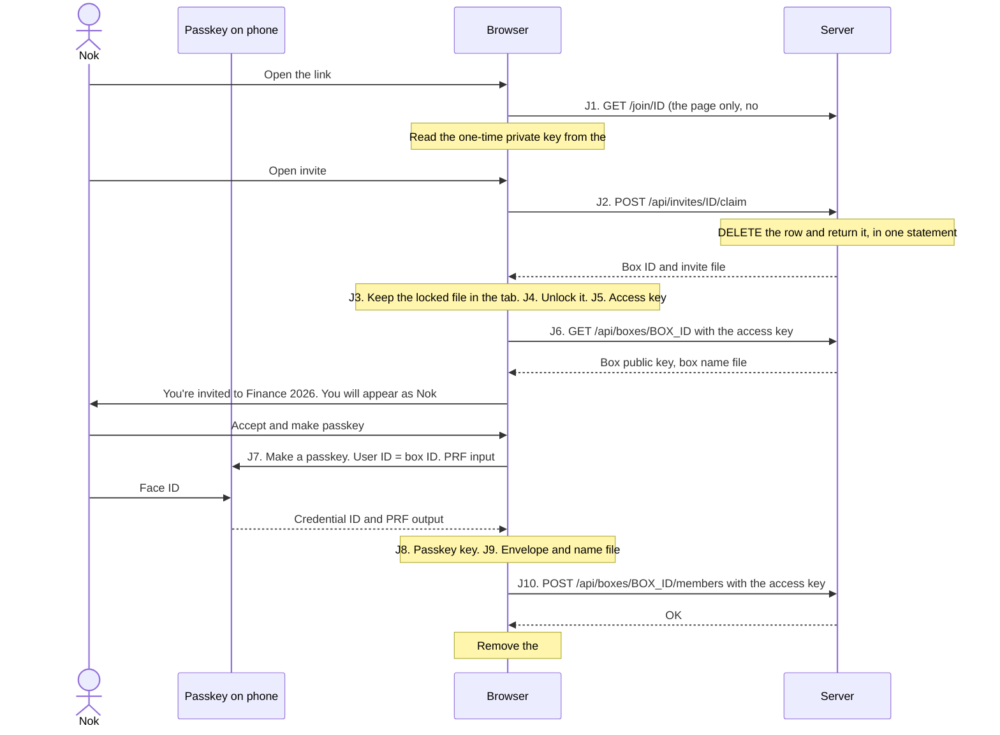
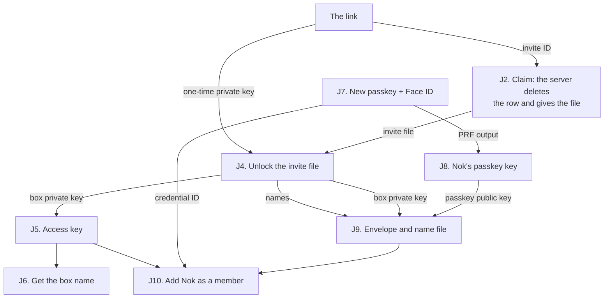

# 5. A person uses an invite link

[← All documents](README.md) · [Word list](README.md#the-words-in-these-documents)

## In short

Nok gets the link from Tiger. She opens it and selects **Open invite**. The server gives the invite file one time, and then deletes it. Nok's browser unlocks it with the key from the link. Now it has the box private key.

Nok sees the box name, and her name in the box. She types nothing. She selects **Accept and make passkey**. Her phone makes a passkey for this box, and her browser locks her own envelope.

Nok uses Face ID one time. Some devices ask two times.

## What Nok sees

1. Open the link from Tiger. The page says "You're invited to a box".
2. Select **Open invite**.
3. The page says: "You're invited to “Finance 2026”. You will appear as Nok in this box." It does not name Tiger: nobody gave the box creator a name, and Nok knows who sent the link. There is nothing to fill in.
4. Select **Accept and make passkey**.
5. The phone asks to save a passkey with the name "Finance 2026 – Nok". Confirm with Face ID.
6. The box opens. Nok can read the note. The member list shows "Nok (you)", invited by the box creator.

## What happens, in plain words

1. The page loads. The browser reads the one-time private key from the part after `#`. The server gets nothing yet.
2. **Open invite** asks the server for the invite. The server deletes the row and gives the invite file, in one step. Nobody can get it again.
3. The browser keeps the **locked** invite file in this tab, in case Nok reloads the page.
4. The one-time private key unlocks the invite file. The browser gets the box private key and the two names.
5. The browser calculates the access key. With it, the browser gets the box name and shows it.
6. **Accept** makes Nok's passkey for this box. The passkey gives its PRF output: Nok's passkey key.
7. The browser locks the box private key with Nok's passkey public key. This is her envelope. It also locks her name file.
8. The browser sends the envelope and the name file. The server adds Nok as a member. The browser removes the `#` part from the address.

## Who talks to whom



## How the keys flow



## Steps: input, method, output

| Step | Input | Method | Output | Goes to |
|---|---|---|---|---|
| J1. Open the page | The link. | The browser asks for the page `/join/crUC8B9PQQSYQ_-CBMvj7A`. It does not send the part after `#`. | The page. The one-time private key `AGE-SECRET-KEY-15ZZXCTU7YG…`, from the address. | J4 |
| J2. Claim | The invite ID. | `POST /api/invites/:id/claim`. The server runs `DELETE … WHERE id = ? AND expires_at > now RETURNING …`. | Box ID `nbtYKFvPJE6MnspnIVuu4Q`. The invite file, 315 bytes. The row is gone. | J3, J4 |
| J3. Keep the locked file | The box ID and the invite file (J2). | The browser puts them in `sessionStorage`. Only this tab can read it. | A reload or a canceled Face ID can try again, with no new claim. | J4 after a reload |
| J4. Unlock the invite file | The invite file (J2). The one-time private key (J1). | The age recipe backwards: X25519 with `oj15APQX12n1+USE…` gives the shared secret `369099b0e90abfc7…`. HKDF-SHA-256 gives the wrap key `a4b996d0…`. ChaCha20-Poly1305 unlocks the file key `a01d2d96…`. Then the payload. | Box private key `AGE-SECRET-KEY-1Z84DDGND8U…`. The name "Nok". The name of the person who invited: empty (Tiger, the box creator). | J5, J9 |
| J5. Access key | The box private key (J4). | HMAC-SHA-256 with the text `secretbox access key v1`. | `-opAqacwlYsMBtzqm8OLNy6fM6xa3MBHIPav8AuUxBI`. The same value as Tiger's. | J6, J10 |
| J6. Box name | The box ID. The access key (J5). | `GET /api/boxes/:id`. The browser checks the box public key against the box private key. Then it unlocks the box name file. | "Finance 2026". The box public key `age13aa297n0wgzsleu3…` | The screen, J9 |
| J7. Make the passkey | The box ID as the user ID. The label "Finance 2026 – Nok". The PRF input `secretbox passkey key v1`. | WebAuthn `navigator.credentials.create` with the PRF extension. Nok confirms with Face ID. | Credential ID `AyIKBj8-mZ8hDc8Q1fb2PQ`. PRF output `eb73d4f6f9ae7b89…` | J8, J10 |
| J8. Nok's passkey key | The PRF output (J7). | The 32 bytes are the X25519 private key. | Private key `AGE-SECRET-KEY-1ADEAFAHE4E…`. Public key `age1tezucs30m36lnwuc…` | J9 |
| J9. Envelope and name file | The box private key (J4). Nok's passkey public key (J8). The text `{"name":"Nok","invitedBy":""}` and the box public key (J6). | The age recipe with an X25519 stanza, two times. Envelope: file key `062efaca…`, shared secret `53448d8b5f47980b…`. | Nok's envelope, 274 bytes. Nok's name file, 229 bytes. | J10 |
| J10. Join | The credential ID (J7). The envelope and the name file (J9). The access key (J5). | `POST /api/boxes/:id/members` | The server adds the member row. The browser deletes the locked file from the tab and removes the `#` part from the address. | [Scenario 2](02-open-box.md) next time |

Nok's envelope, as the server keeps it:

```
age-encryption.org/v1
-> X25519 mzbKa4Cl4GCeVLa5A6r40u/waeb3C+4EvcW0NofnNHU
RxoLrtd/Nn89wBSzOEFWZOPi6b2vDj/tesSnCAs/PHw
--- xDxM+7/nEe/tenpNc2H+dOrKsXyS+T9XEZwndF4ns3w
[106 bytes: the box private key, locked]
```

Nok's envelope holds the same box private key as Tiger's envelope. But Tiger's passkey key cannot unlock Nok's envelope, and Nok's passkey key cannot unlock Tiger's. The script [example-data.mjs](technical/example-data.mjs) checks this.

## Why opening the page changes nothing

Chat apps (LINE, Slack, iMessage) load a link to show a preview. They send `GET` requests. Only the **Open invite** button sends the `POST` that uses the invite. So a link preview does not use up the invite.

## If Nok stops halfway

| Nok stops… | What happens |
|---|---|
| Before **Open invite** | Nothing changed. The link still works. |
| After **Open invite**, and she reloads the page | The tab still has the locked invite file. The page shows the invite again. |
| After **Open invite**, and she cancels Face ID | She selects **Accept and make passkey** again. |
| After **Open invite**, and she closes the tab | The claim used up the link. Nobody joined. A member must make a new link. |

## Result

| Where | What |
|---|---|
| Phone or password manager | The passkey "Finance 2026 – Nok". |
| Server | A new member row: Nok's credential ID, her envelope, her name file. The invite row is gone. |
| Browser tab memory | The box private key and the access key, until **Lock**, a reload or a closed tab. |

| Action | Face ID |
|---|---|
| Join with an invite link | 1 (2 on some devices) |

## Technical details

- [Passkey PRF (steps J7 and J8)](technical/passkey-prf.md)
- [The X25519 stanza (steps J4 and J9)](technical/age-format.md)
- [API calls and database statements (steps J2, J6 and J10)](technical/api-and-sql.md)

[← Previous](04-create-invite.md) · [Next: an expired or used link →](06-invite-expired-or-reused.md)
