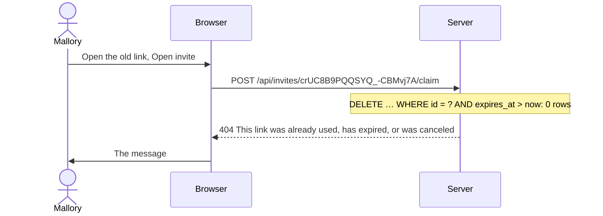
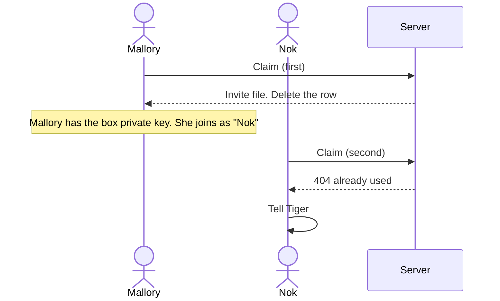

# 6. An invite link is expired, or another person opens a used link

[← All documents](README.md) · [Word list](README.md#the-words-in-these-documents)

## In short

An invite link works one time, and only for a limited time. After that, the server has no invite file for it. So the one-time private key in the link unlocks nothing.

The server gives one answer for all cases. The row is gone, so the server cannot know which case it is.

## What Mallory sees

Mallory finds Nok's link in an old chat. Nok used it before.

1. Open the link. The page says "You're invited to a box".
2. Select **Open invite**.
3. The page shows "This link no longer works" and the reason: "This link was already used, has expired, or was canceled."
4. Mallory gets nothing: no box name, no names, no key.

## What happens, in plain words

1. Mallory's browser reads the one-time private key from the `#` part. This key is correct.
2. **Open invite** asks the server for the invite.
3. The server looks for an open row with this ID. There is none, because the server deleted it when Nok opened the link.
4. The server answers "not found". Without the invite file, the one-time private key is useless.

## Who talks to whom

## The four cases

| Case | Why the claim finds no row | When the server deleted the invite file |
|---|---|---|
| **Used** | The first person who selected **Open invite** got the row. | At that claim, in the same statement. |
| **Canceled** | A member selected **Cancel**. | At the cancel. |
| **Expired** | The claim asks for `expires_at > now`. | When somebody makes or opens any invite after the time limit. Until then the row stays, but the server never gives it out. |
| **Wrong ID** | The ID is not in the database. | There was never a row. |

## Steps: input, method, output

| Step | Input | Method | Output | Goes to |
|---|---|---|---|---|
| R1. Read the link | The link. | The browser reads the `#` part. | One-time private key `AGE-SECRET-KEY-15ZZXCTU7YG…` | R3 |
| R2. Claim | The invite ID `crUC8B9PQQSYQ_-CBMvj7A`. | The server first deletes all expired invites. Then it runs `DELETE FROM invites WHERE id = ? AND expires_at > ? RETURNING box_id, invite_file`. | 0 rows. HTTP 404. | R3 |
| R3. Unlock | The one-time private key (R1). No invite file. | Nothing to unlock. | Nothing. | |

## Another person uses the link first

This case is different. The link goes to a group chat by mistake. Mallory opens it **before** Nok.

1. Mallory selects **Open invite**, then **Accept and save passkey**. She joins the box.
2. The member list shows her as "Nok", invited by the box creator, because Tiger typed the name "Nok".
3. Later, the real Nok opens the link. She sees "already used".

**What Tiger must do:**

1. Believe Nok. Somebody else has the box private key.
2. Remove the false "Nok". This deletes only her envelope. She can keep the box private key and the access key. See [flaw 2](08-security.md#2-removal-deletes-only-the-envelope).
3. To stop her fully: make a new box, move the data into it, and invite the correct people.

**How to prevent it:** Send links only in private chats. Use short time limits. Ask the person to tell you when they joined.

## What stays in the database

| State | Invite row | Invite file |
|---|---|---|
| Open | Yes | Yes |
| Used | No | No |
| Canceled | No | No |
| Expired, before the next invite action | Yes, but the server never gives it out | Yes |
| Expired, after the next invite action | No | No |

"Deleted" means that the row is gone from the live database. Database backups and the restore history of Neon can still have it. See [flaw 4](08-security.md#4-deleted-invite-files-stay-in-backups).

## Result

| Action | Face ID |
|---|---|
| Open a used, expired or canceled link | 0. The page stops before the passkey step. |

## Technical details

- [API calls and database statements](technical/api-and-sql.md)

[← Previous](05-use-invite.md) · [Next: what the database keeps →](07-storage.md)
