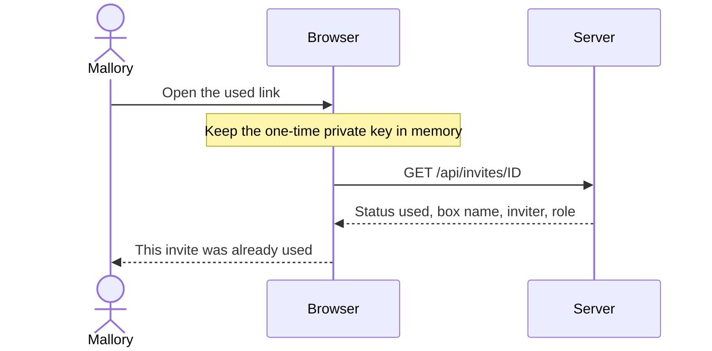
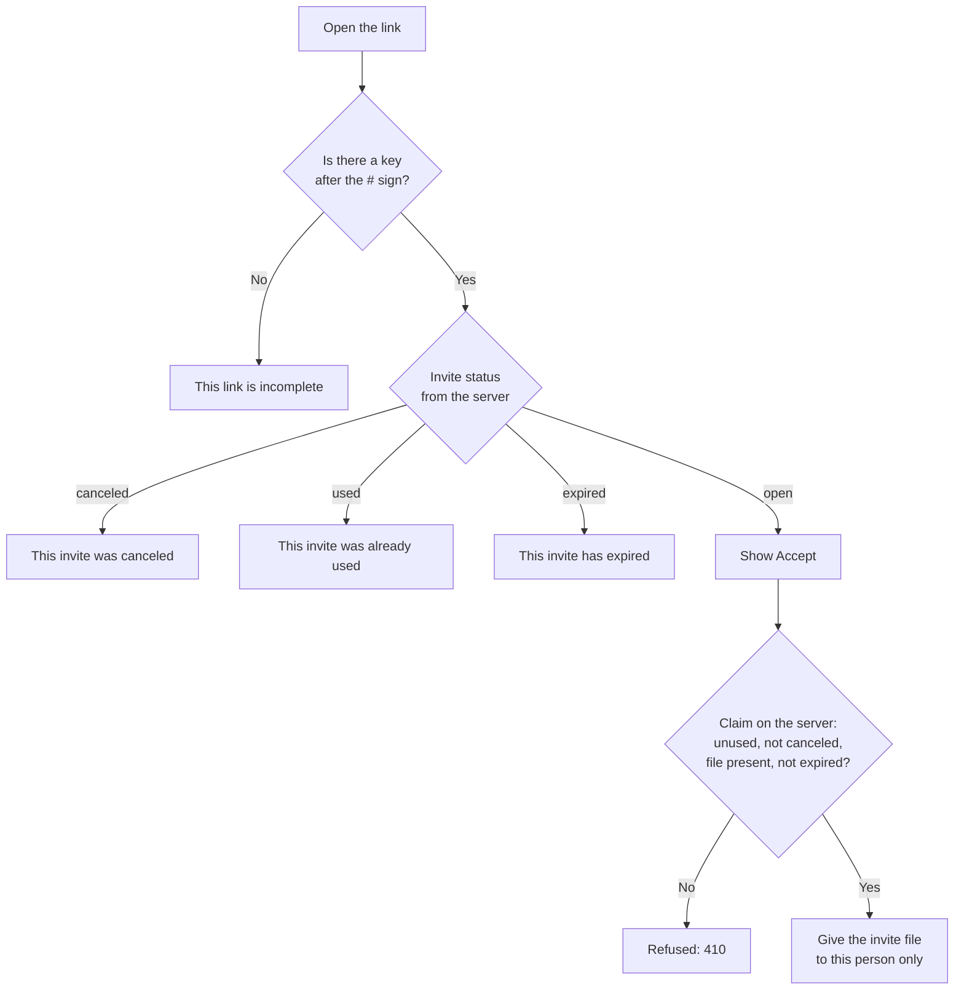
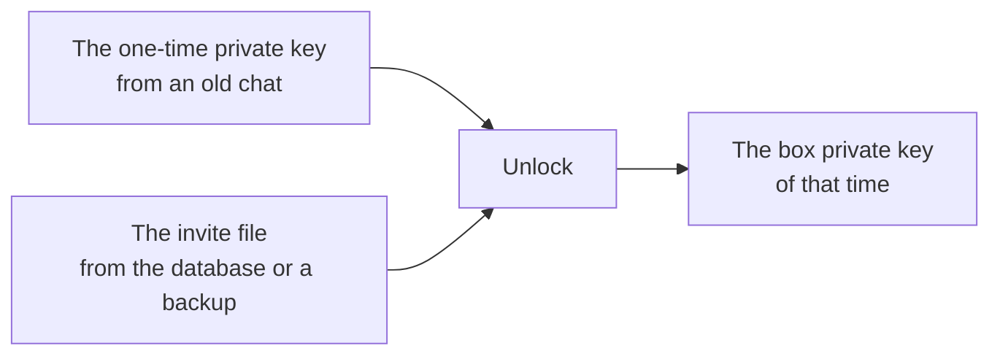

# 6. An invite link is expired, or another person opens a used link

[← All documents](README.md) · [Word list](README.md#the-words-in-these-documents)

## In short

An invite link works one time and for a limited time. After that, the page shows a message and does not let anybody join.

Two things make the link useless:

1. **The server lets only one person use the link.** A second person gets the message "already used".
2. **The server deletes the invite file** when the person finishes joining. The one-time private key in the link then has nothing to unlock.

> **CAUTION:** In some cases the server does **not** delete the invite file. See [What stays in the database](#what-stays-in-the-database). These cases are flaws. [Document 8](08-security.md) lists them.

## What Mallory sees

Mallory finds Nok's link in an old chat, after Nok joined.

1. Open the link.
2. The page shows: "This invite was already used. Ask the person who sent it for a new link."
3. There is no **Accept** button.

With an expired link, the page shows "This invite has expired." With a canceled link, it shows "This invite was canceled."

## What happens, in plain words

1. The page loads. The browser reads the one-time private key from the link into memory.
2. The browser asks the server for the invite status. The server changes nothing.
3. The status is not "open", so the page shows a message and stops.
4. The browser does not send the one-time private key anywhere. It does not ask for the invite file.

## Who talks to whom

## How the page and the server decide

The server calculates the status in this order:

| Order | Status | Condition in the invite row |
|---|---|---|
| 1 | canceled | `canceled_at` has a value. |
| 2 | used | `used_by` or `completed_at` has a value. |
| 3 | expired | `expires_at` is in the past. |
| 4 | open | None of the conditions above. |

## Steps: input, method, output

| Step | Input | Method | Output | Goes to |
|---|---|---|---|---|
| 1. Read the link | The link `…/join/n2Wct0b4C-ivqkLH2pCjjw#AGE-SECRET-KEY-1ZQYRVJWHT7S…` | The browser reads the part after `#`. | The one-time private key, in memory only. | Not used |
| 2. Get the status | The invite ID. | `GET /api/invites/:id`. No sign-in is necessary. Nothing changes. | Box name "Finance 2026". Inviter "Tiger". Label "Nok, finance". Role "reader". Status "used". | Step 3 |
| 3. Decide | The status. | The page compares it with "open". | A message. No **Accept** button. | |

### If Mallory sends the claim herself

Mallory can make an account and call the API directly, without the page. The server still refuses:

| Step | Input | Method | Output |
|---|---|---|---|
| A. Claim | The invite ID. Mallory's session cookie. | `POST /api/invites/:id/claim`. The `UPDATE … WHERE used_by IS NULL …` statement changes 0 rows. | `410`: "This invite was already used." |
| B. Unlock | The one-time private key. | She has no invite file. The server did not give it to her, and the server deleted it. | Nothing |

## Each status, and what is left

| Status | How it happens | Invite file in the database | Can a person still join? |
|---|---|---|---|
| open | Not used, not expired, not canceled. | Kept | Yes. The first person who selects **Accept**. |
| used, completed | The person finished joining. | **Deleted** | No |
| used, not completed | The person claimed, but the join stopped before step 9 of [scenario 5](05-use-invite.md). | **Kept** | The server allows only that same person. But the page shows "already used", so that person cannot finish through the page. This is a flaw. |
| expired | The time limit passed before anybody used it. | **Kept** | No. This is a flaw: the server should delete the file. |
| canceled | An admin canceled it, or an admin changed the box key. | **Deleted** | No |

## What stays in the database

In two statuses, the database keeps the invite file after the link stops working: "expired" and "used, not completed".

A deleted file can also stay in database backups. Neon, the database service, keeps a restore history.

The danger needs **two** things together:

A person who has both gets the box private key of that time. With it, the person can read each item that this box key locked. To get those items, the person needs the database or a backup too.

The page and the API cannot give the invite file to such a person. The danger is only for a person with access to the database or its backups.

## What Tiger sees

In the box page, under **Invites**, Tiger sees each invite with its status and who used it. For example: "Nok, finance · used · used by Nok".

If the wrong person used a link, Tiger can remove that person. This changes the box key. See [document 7](07-storage.md#key-history-after-a-member-is-removed).

## A link that leaks before it is used

The link is a secret until somebody uses it. If Mallory gets the link **before** Nok, Mallory can join. Then Nok sees "already used".

To decrease this risk:

1. Send the link in a private chat only.
2. Use a short time limit.
3. After somebody uses the invite, look at **used by** in the invite list.

## Technical details

- [API calls and database statements](technical/api-and-sql.md)
- [Security flaws and limits](08-security.md)

[← Previous](05-use-invite.md) · [Next: what the database keeps →](07-storage.md)
