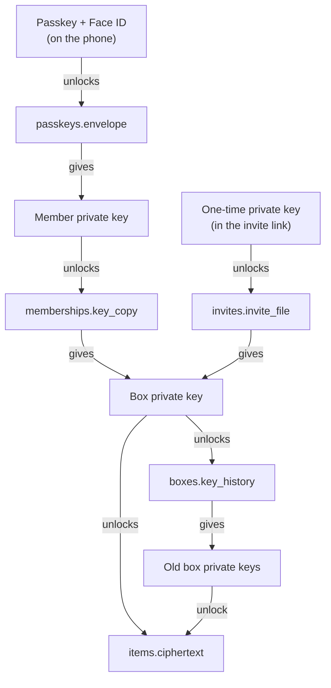
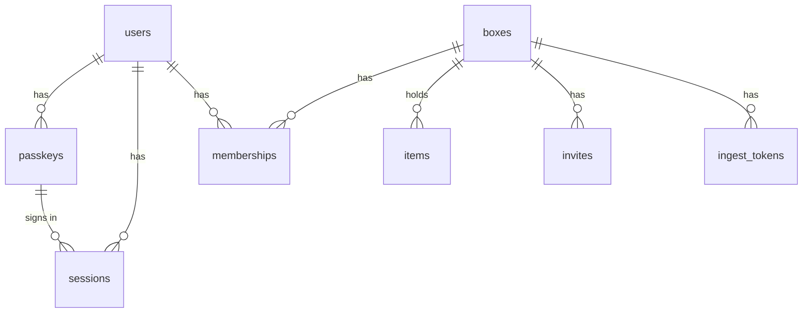

# 7. What the database keeps

[← All documents](README.md) · [Word list](README.md#the-words-in-these-documents)

## In short

The database is Postgres (Neon). It keeps three kinds of things:

1. **Locked files (age files).** The envelopes, the key copies, the items, the invite files and the key history. The server cannot open them.
2. **Public keys.** They can lock, but they cannot unlock. So they are not secret.
3. **Information that is not locked.** Names, sizes, dates and who is in which box.

The database never keeps these in a form that a person can read: private keys, passkey outputs, the data of items, sign-in tokens.

## Which key unlocks which column

## The tables

In the tables below, **Locked** means "an age file". **Hash** means "a SHA-256 value that nobody can reverse".

### users: one row for each person

| Column | Kind | Example | Notes |
|---|---|---|---|
| `id` | Clear | random ID | 16 random bytes, base64url. |
| `nickname` | Clear | `Tiger` | The account name. The box creator types it. For an invited person, it comes from the first invite. |
| `webauthn_user_id` | Clear | random ID | The user ID inside the passkey. |
| `member_recipient` | Public key | `age1gffpl2mrf5g92mje…` | Locks key copies for this person. |
| `created_at` | Clear | time in milliseconds | |

### passkeys: one row for each passkey

| Column | Kind | Example | Notes |
|---|---|---|---|
| `id` | Clear | `nIqF2ASScSdBg5JqLm1Kcw` | The passkey credential ID. |
| `user_id` | Clear | Tiger's ID | |
| `public_key` | Public key | COSE bytes | Verifies sign-in signatures. It cannot unlock anything. |
| `counter` | Clear | `0` | The passkey's signature counter. |
| `transports` | Clear | `["internal","hybrid"]` | How the browser can reach the passkey. |
| `envelope` | **Locked** | 274 bytes, fido2prf stanza | Holds the member private key. Only this passkey unlocks it. |

### sessions: one row for each sign-in

| Column | Kind | Example | Notes |
|---|---|---|---|
| `token_hash` | **Hash** | `a01c59a2922989…` | The cookie holds the token `vjCmUsAHogdl4B-Y…`. The database keeps only its hash. |
| `user_id`, `passkey_id` | Clear | | Which person and which passkey signed in. |
| `expires_at` | Clear | 30 days after sign-in | |

### webauthn_flows: passkey challenges

| Column | Kind | Notes |
|---|---|---|
| `id`, `challenge` | Clear | A random challenge for one passkey request. |
| `data` | Clear | The address, the passkey domain and the name. |
| `expires_at` | Clear | 5 minutes. The server deletes the row when it uses it. |

### boxes: one row for each box

| Column | Kind | Example | Notes |
|---|---|---|---|
| `id` | Clear | random ID | |
| `name` | Clear | `Finance 2026` | |
| `recipient` | Public key | `age1cmaf95n0vkusfv0s…` | The current box public key. It locks new items. |
| `key_version` | Clear | `1` | Increases each time a member changes the box key. |
| `key_history` | **Locked** | empty until the box key changes | Holds old box private keys. The current box private key unlocks it. |
| `created_by`, `created_at` | Clear | | |

### memberships: one row for each person in each box

| Column | Kind | Example | Notes |
|---|---|---|---|
| `box_id`, `user_id` | Clear | | Who is in which box. |
| `name` | Clear | `Nok` | How the person appears in this box. The person who invited them typed it. |
| `key_copy` | **Locked** | 274 bytes, X25519 stanza | Holds the box private key. The person's member private key unlocks it. |
| `invited_by`, `joined_at` | Clear | | |

### items: one row for each item

| Column | Kind | Example | Notes |
|---|---|---|---|
| `id`, `box_id` | Clear | | |
| `name` | Clear | `note.txt` | **Not locked.** |
| `ciphertext` | **Locked** | 221 bytes, X25519 stanza | The item. A box private key unlocks it. |
| `size` | Clear | `221` | The size of the age file. |
| `added_by`, `source` | Clear | Tiger's ID, `app` | `source` is `ingest:<label>` for items from another system. |
| `created_at` | Clear | | |

### invites: one row for each invite link

| Column | Kind | Example | Notes |
|---|---|---|---|
| `id` | Clear | `n2Wct0b4C-ivqkLH2pCjjw` | The part of the link before `#`. |
| `box_id`, `name` | Clear | `Nok` | The name of the invited person. |
| `invite_file` | **Locked** | 274 bytes, X25519 stanza | Holds the box private key. The one-time private key from the link unlocks it. The server sets it to empty when a person completes the invite or a member cancels it. |
| `created_by`, `created_at`, `expires_at` | Clear | | |
| `used_by`, `used_at` | Clear | Nok's ID | Set by the claim. |
| `completed_at`, `canceled_at` | Clear | | |

### ingest_tokens: one row for each token for another system

| Column | Kind | Notes |
|---|---|---|
| `token_hash` | **Hash** | The app shows the token `sbx_…` one time. The database keeps only its hash. |
| `box_id`, `label`, `created_by`, `created_at` | Clear | |

## Example: all rows for Tiger, Nok and "Finance 2026"

| Table | Rows | Locked columns |
|---|---|---|
| users | Tiger, Nok | none |
| passkeys | Tiger's passkey, Nok's passkey | 2 envelopes |
| sessions | 1 or more for each person | none (hashes only) |
| boxes | Finance 2026, HR 2027 | key history (empty) |
| memberships | Tiger in Finance, Tiger in HR, Nok in Finance (invited by Tiger) | 3 key copies |
| items | note.txt | 1 item |
| invites | "Nok": completed | invite file deleted |

## Key history: after a member is removed

When a member removes another member, the box key changes. The server deletes the removed member's key copy. The new box private key goes only to the members who stay.

| Step | Input | Method | Output | Goes to |
|---|---|---|---|---|
| 1. Get the old keys | The key copy of the member who removes. The key history, if it exists. | Unlock, as in [scenario 3](03-add-item.md). | The current box private key `AGE-SECRET-KEY-1TECYTY27F3E…` and all older ones. | Step 3 |
| 2. Make the new box key | Random bytes. | X25519 key generation. | A new box key pair. | Steps 3 and 4 |
| 3. Lock the old keys | The list of old box private keys, as JSON. The new box public key. | age file with an X25519 stanza. | The new **key history**. | Step 5 |
| 4. Lock new key copies | The new box private key. The member public key of each member who stays. | age file with an X25519 stanza, one for each member. | New **key copies**. No Face ID is necessary for them. | Step 5 |
| 5. Keep it all | Steps 3 and 4. The box key version that the browser used. | `POST /api/boxes/:id/rotate`. One transaction with a row lock. | The server deletes the removed membership. It keeps the new key copies and the new box public key. It adds 1 to `key_version`. It cancels all open invites. | |

Old items stay locked to the old box key. Members who stay unlock them through the key history. The removed member has no key copy any more, and the server refuses to give them items.

## What is not locked

| Information | Where |
|---|---|
| Names | `users.nickname`, `memberships.name`, `invites.name` |
| Box names | `boxes.name` |
| Item names, sizes and dates | `items` |
| Who is in which box, and who invited whom | `memberships` |
| Invite names and who used each invite | `invites` |

A person with access to the database can read this information. See [document 8](08-security.md).

## Technical details

- [API calls and database statements](technical/api-and-sql.md)
- [age file format](technical/age-format.md)

[← Previous](06-invite-expired-or-reused.md) · [Next: security flaws and limits →](08-security.md)
