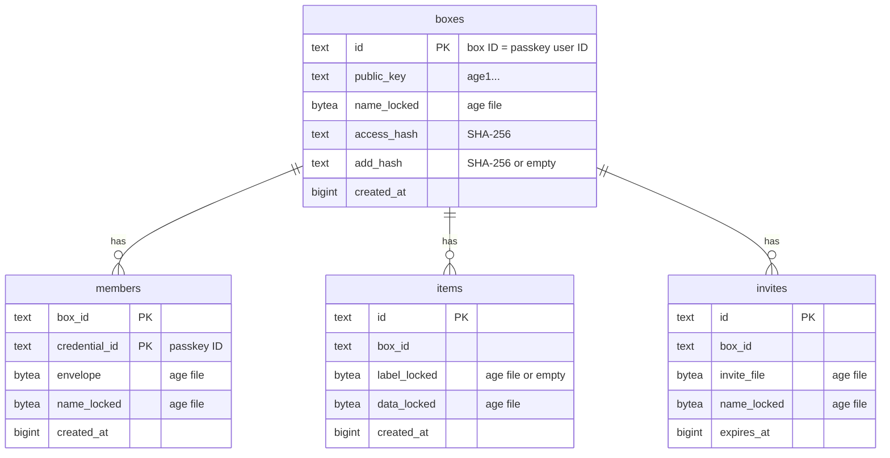

# 7. What the database keeps

[← All documents](README.md) · [Word list](README.md#the-words-in-these-documents)

## In short

The database has four tables: `boxes`, `members`, `items` and `invites`. Each private value is an age file. The server cannot unlock any of them.

The server keeps no accounts, no passwords, no email addresses, no passkey public keys and no sessions. It keeps the hash of each access key and each add key, not the keys.

## The tables

Every column with a name that ends in `_locked` holds an age file. The box public key locked it, so only members can unlock it.

## Example rows

The values come from scenarios 1 to 5.

### `boxes`

| Column | Example | Locked? | What it is |
|---|---|---|---|
| `id` | `Ze3WdI5DdSbboy05-E6vhQ` | No | The box ID. Also the user ID of each passkey for this box. |
| `public_key` | `age1aa0rtwwaz8rhsdt24338…` | No | The box public key. Anybody may lock data with it. |
| `name_locked` | age file, 212 bytes | **Yes** | "Finance 2026". |
| `access_hash` | `753a4c5b86ec2461…` | Hash | SHA-256 of the access key. |
| `add_hash` | `f380ac83935d686b…` or empty | Hash | SHA-256 of the add key, if a member made one. |
| `created_at` | `1795683600000` | No | The time, in milliseconds. |

### `members`

| `box_id` | `credential_id` | `envelope` | `name_locked` |
|---|---|---|---|
| `Ze3WdI5DdSbboy05-E6vhQ` | `jnx3yrksw0nZ_pk2v1xPmQ` | age file, 274 bytes: the box private key, for Tiger's passkey key | age file, 233 bytes: `{"name":"Tiger","invitedBy":null}` |
| `Ze3WdI5DdSbboy05-E6vhQ` | `FSMScb5Fz658XBQXVw5XCA` | age file, 274 bytes: the box private key, for Nok's passkey key | age file, 234 bytes: `{"name":"Nok","invitedBy":"Tiger"}` |

### `items`

| `id` | `label_locked` | `data_locked` |
|---|---|---|
| `…` | age file, 267 bytes: `{"name":"note.txt",…,"addedBy":"Tiger"}` | age file, 221 bytes: the note |
| `…` | empty | age file from an outside system |

### `invites`

| `id` | `invite_file` | `name_locked` | `expires_at` |
|---|---|---|---|
| `iFhx-052UgwYFJqH7AhiuA` | age file, 320 bytes: the box private key and two names, for the one-time key | age file, 234 bytes: `{"name":"Nok","invitedBy":"Tiger"}` | `1795770000000` |

When Nok opened the link, the server deleted this row.

## What the server can see

| The server can see | The server cannot see |
|---|---|
| How many boxes, members, items and open invites there are. | Box names, person names, item names, item types. |
| The size of each age file, so about how large each item is. | The data. |
| The time of each change. | Who added an item. The label holds this. |
| Which passkey (credential ID) opens which box. | Which person has which passkey. |
| The access key, in each request. | Private keys, PRF outputs, passkey public keys. |
| The IP address of each request. | The part of an invite link after `#`. |

**The access key in each request.** The server calculates its hash and then forgets it. But a person who controls the server can record it. With the access key, that person can use the API like a member: get the locked files, delete items, remove members. The access key cannot unlock anything. See [flaw 5](08-security.md#5-the-access-key-works-like-a-password-for-the-box).

## What a database thief gets

A person steals the database or a backup. They get:

- the age files, which they cannot unlock,
- the box public keys, which can lock but cannot unlock,
- the hashes, which do not give the keys back,
- the counts, sizes, times and credential IDs from the table above.

To unlock a box, they also need one of these:

- a member's passkey and Face ID,
- an unused invite link, and a copy of the database from before somebody used the link,
- the box private key from a member's browser.

## Old tables in the live database

The first versions of Secretbox had accounts. The live database on Vercel still has their tables (`users`, `passkeys`, `sessions`, `webauthn_flows`, `memberships`, `ingest_tokens`) and some old columns. The new version does not read them. A later cleanup can delete them. See [technical/api-and-sql.md](technical/api-and-sql.md#upgrade-from-the-first-version).

## Technical details

- [API calls and database statements](technical/api-and-sql.md)

[← Previous](06-invite-expired-or-reused.md) · [Next: security flaws and limits →](08-security.md)
