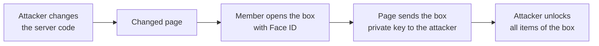

# 8. Security flaws and limits

[← All documents](README.md) · [Word list](README.md#the-words-in-these-documents)

## In short

Secretbox protects data against people who **keep** the data: the database, its backups, and the hosting companies. They get only locked files and hashes.

Secretbox does **not** fully protect data against people who **control the server code**. The server sends the page that unlocks the data. A changed page can steal keys.

Secretbox has no accounts. A person is a member because they have the box private key. This makes the system simple, but it also means that **nobody can take the box private key back** from a person who had it.

This document lists each known flaw. Each flaw has a level:

- **High:** a person can read the data of a box.
- **Medium:** a person can read some data or information, or damage data, but only with special access or special luck.
- **Low:** a problem with use, or a small risk.

## Summary

| # | Flaw | Level | Status |
|---|---|---|---|
| 1 | The server sends the code that holds the keys | High | Design limit |
| 2 | Removal deletes only the envelope | High | Design choice |
| 3 | An invite link is a secret until somebody uses it | Medium | Design limit |
| 4 | Deleted invite files stay in backups | Medium | Design limit |
| 5 | The access key works like a password for the box | Medium | Design choice |
| 6 | Every member can do everything | Medium | Design choice |
| 7 | X25519 is not safe against future quantum computers | Medium | A fix is possible. |
| 8 | Sizes, times and counts are not locked | Low | Design limit |
| 9 | The passkey label shows the box name and the person's name | Low | Design choice |
| 10 | An opened invite is lost if the tab closes | Low | Design limit |
| 11 | A lost passkey means lost access | Low | A member can send a new link. |
| 12 | No rate limits, no audit log | Low | Not built yet |
| 13 | Unlocked data stays in the browser tab | Low | A fix is possible. |
| 14 | Passkey PRF support is not the same everywhere | Low | Design limit |

## 1. The server sends the code that holds the keys

**What:** The browser unlocks data with JavaScript that the server sends. The server can send changed JavaScript.

**Who can use it:**

- A person who controls the Vercel account.
- Vercel.
- A person who can push to the `main` branch. Each push deploys automatically.
- A person who changes a library that the app uses (for example Typage), before the build.

**Effect:** The changed page waits for the next Face ID. Then it sends the box private key or the data to the attacker. The user sees nothing unusual. After one member of a box opens it, the attacker can read all items of that box, now and later.

**How to decrease the risk:**

- Protect the Vercel account and the `main` branch (two-factor sign-in, branch protection, review of each change).
- Keep library versions fixed (`package-lock.json`) and examine each update.
- Serve the page from a separate place that does not change often. Publish the hash of each build, so people can verify it.
- For the highest protection, make a native app. Code changes then go through app releases.

## 2. Removal deletes only the envelope

**What:** When a member removes a person, the server deletes that person's envelope. Their passkey then opens nothing. But the box key does not change. If the person kept a copy of the box private key, they keep everything:

- They can calculate the access key. The server then answers them like any member.
- They can read all items, also new items.
- They can make invite links.

**Who can use it:** A removed member who copied the box private key from the browser. A normal person does not do this. A person who plans it can.

**Effect:** Removal stops a lost or stolen phone. It does not stop a person who wants to keep access.

**Why:** A real removal needs a new box key, and a new envelope for each member who stays. The browser cannot make an envelope for another person, because it does not know their passkey public key. Each member would have to join again.

**How to decrease the risk:**

- To cut a person off fully, make a new box. Move the data into it. Invite the people who must stay.
- Give access only to people you trust with the whole box, for as long as the box exists.

## 3. An invite link is a secret until somebody uses it

**What:** The first person who opens the link gets the box private key. The server cannot know if that person is the correct person. That person then joins with the name that the inviter typed.

**Who can use it:** A person who sees the link before the correct person uses it. For example, a person in a group chat.

**Effect:** That person reads the box. The member list shows them with the correct person's name. The correct person sees "already used". Because of flaw 2, removal does not stop them.

**How to decrease the risk:** Send links in private chats only. Use short time limits. Ask each person to confirm that they joined. If a person sees "already used" but did not use the link, make a new box. See [scenario 6](06-invite-expired-or-reused.md#another-person-uses-the-link-first).

## 4. Deleted invite files stay in backups

**What:** "Deleted" means that the row is gone from the live database. Neon keeps a restore history, and backups can keep old rows. An expired row also stays until somebody makes or opens an invite.

**Who can use it:** A person who has the link, for example from an old chat. That person also needs a database backup from before somebody used the link.

**Effect:** That person can unlock the invite file and get the box private key.

**How to decrease the risk:** Use short invite time limits. Keep the backup history short. Run a regular cleanup that deletes expired invites.

## 5. The access key works like a password for the box

**What:** The browser sends the access key with each request for a box. The server keeps only its hash, but it sees the key in each request.

**Who can use it:** A person who controls the server and records the keys. A browser extension that reads the page's requests.

**Effect:** With the access key, a person can do on the server what a member can do. They can get the locked files, add or delete items, remove members, and make or cancel invites. The access key **cannot unlock** anything. So this person can damage data, but cannot read it.

**How to decrease the risk:** Keep backups of the database. A later version can use a signature for each request, so the server never sees a reusable key.

## 6. Every member can do everything

**What:** There are no roles. Each member can:

- invite any person, and those people can invite more people,
- remove any other member, also the person who made the box,
- delete items,
- make or turn off the add key.

The server stops only one thing: it does not remove the last member of a box.

**Who can use it:** Any member, for example a careless member or a member whose phone is stolen.

**Effect:** Access can spread further than the first person wanted. One member can remove others or delete data.

This is a deliberate choice. Encryption cannot make a member "read only": each member has the box private key and can copy each item.

**How to decrease the risk:**

- Each member row shows **invited by**, so the members can see how access spread.
- Give access only to people you trust with the whole box.
- A later version can keep deleted items for some days, so a member can undo a deletion.

## 7. X25519 is not safe against future quantum computers

**What:** A large quantum computer could break X25519 in the future. All age files in Secretbox use X25519: envelopes, items, names and invite files.

**Who can use it:** A person who copies the database now and keeps it for many years.

**Effect:** They could unlock those files in the future.

**Fix:** Use hybrid post-quantum keys. Typage has `generateHybridIdentity()`. The passkey key would then come from the PRF output through a hybrid key derivation. Other systems then need age 1.3 or later to add items.

## 8. Sizes, times and counts are not locked

**What:** The browser locks names and labels. It does not lock these: the size of each file, the time of each change, and the number of members and items. The server also knows which credential ID opens which box. It also sees IP addresses.

**Who can use it:** A person with database or server access.

**Effect:** They can guess how active a box is, and how large each item is.

**Fix:** Add random padding to items. This makes sizes less exact.

## 9. The passkey label shows the box name and the person's name

**What:** The phone saves each passkey with a label, for example "Finance 2026 – Nok". The password manager keeps it in clear text, and Apple or Google syncs it.

**Who can use it:** A person who can look at the phone's password list. The password manager company.

**Effect:** They see the box names and the person's name. They cannot open the box without Face ID.

**Fix:** Use a neutral label. But then the passkey list is harder to use.

## 10. An opened invite is lost if the tab closes

**What:** **Open invite** uses up the link. The tab keeps the locked invite file, so a reload or a canceled Face ID can try again. If the person closes the tab before **Accept**, the link is gone.

**Effect:** Nobody joined. A member must send a new link.

## 11. A lost passkey means lost access

**What:** Only the person's passkey can unlock their envelope.

**Effect:** If a person loses a passkey that does not sync, they lose access to that box. Synced passkeys (Apple, Google) make this less likely.

**Fix:** Any member can send the person a new link. This is also how a person adds a device that does not sync. A member should then remove the old entry.

## 12. No rate limits, no audit log

**What:**

- The server does not limit how many requests a person can send. Anybody can make boxes.
- The server does not record who opened which item. It does not know who a person is.

**Fix:** Add rate limits before real use.

## 13. Unlocked data stays in the browser tab

**What:** The box private key and the access key stay in tab memory until the tab closes or the person selects **Lock**. The download link for an item stays in memory until the tab closes. During a join, the tab also keeps the locked invite file, and the address bar holds the one-time key.

**Who can use it:** A person who uses the same unlocked device. A browser extension with access to the page.

**Fix:** Lock automatically after some minutes without use. Free the download link after use.

## 14. Passkey PRF support is not the same everywhere

**What:** Apple Passwords, Google Password Manager and recent security keys support PRF. Some other password managers do not. Some devices give the PRF output only when a person uses a passkey, so making a passkey needs two Face IDs there.

**Effect:** Some people cannot make a passkey that opens a box. The app shows a message.

## Fixed in this version

| Flaw in the first version | What changed |
|---|---|
| Expired invites kept the invite file. | The server deletes the row when a person uses the link, when a member cancels it, and after the time limit. |
| A stopped join could not continue. | The tab keeps the locked invite file. A reload or a canceled Face ID can try again. |
| Names, box names and item names were not locked. | They are in name files and labels now. The join page shows nothing before **Open invite**. |
| The server could give a wrong public key. | The browser checks the box public key against the box private key. The server cannot make a false envelope, because it never gets a passkey public key. |
| A stolen member key also opened future key copies. | There are no member keys and no key copies. |

## What Secretbox does protect

| Threat | Protected? |
|---|---|
| A person steals the database or a backup | Yes. Only locked files, public keys and hashes. Exceptions: flaws 4 and 8. |
| A person reads network traffic | Yes. HTTPS. Also, private keys and data are never sent. |
| A person uses a link a second time | Yes. The server deletes the invite when the first person opens it. |
| A link preview in a chat app | Yes. Previews send `GET`. Only the `POST` of **Open invite** uses the invite. |
| A changed or damaged age file | Yes. The header check and the payload tags find each change. |
| The server gives a false public key or envelope | Yes. See "Fixed in this version". |
| Another website sends requests as the user | Yes. There are no cookies. Each request needs the access key, and other websites cannot read it. |
| A person controls the server code | **No.** See flaw 1. |
| A removed member who kept the box private key | **No.** See flaw 2. |

## Technical details

- [age file format](technical/age-format.md)
- [Passkey PRF](technical/passkey-prf.md)
- [Passkeys, access keys and add keys](technical/passkeys-and-access-keys.md)
- [API calls and database statements](technical/api-and-sql.md)

[← Previous](07-storage.md) · [All documents](README.md)
