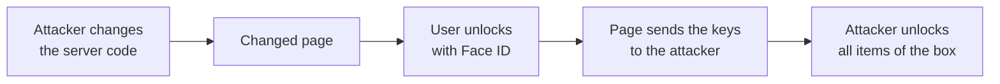

# 8. Security flaws and limits

[← All documents](README.md) · [Word list](README.md#the-words-in-these-documents)

## In short

Secretbox protects data against people who **keep** the data: the database, its backups, and the hosting companies. They get only locked files.

Secretbox does **not** fully protect data against people who **control the server code**. The server sends the page that unlocks the data. A changed page can steal keys.

This document lists each known flaw. Each flaw has a level:

- **High:** a person can read the data of a box.
- **Medium:** a person can read some data or information, but only with special access or special luck.
- **Low:** a problem with use, or a small risk.

## Summary

| # | Flaw | Level | Status |
|---|---|---|---|
| 1 | The server sends the code that holds the keys | High | Design limit |
| 2 | The server can give a wrong public key | High | Design limit. A fix is possible. |
| 3 | Expired invites keep the invite file | Medium | Bug. Easy to fix. |
| 4 | Deleted invite files stay in backups | Medium | Design limit |
| 5 | A removed member keeps what they read | Medium | Design limit |
| 6 | A stolen member private key also opens future key copies | Medium | A fix is possible. |
| 7 | Names, sizes, dates and members are not locked | Medium | Design limit |
| 8 | An invite link is a secret until somebody uses it | Medium | Design limit |
| 9 | X25519 is not safe against future quantum computers | Medium | A fix is possible. |
| 10 | A person cannot finish a stopped join through the page | Low | Bug. Easy to fix. |
| 11 | A lost passkey means lost access | Low | A fix is possible. |
| 12 | No rate limits, no audit log, no way to cancel tokens | Low | Not built yet |
| 13 | Unlocked data stays in the browser tab | Low | A fix is possible. |
| 14 | Passkey PRF support is not the same everywhere | Low | Design limit |

## 1. The server sends the code that holds the keys

**What:** The browser unlocks data with JavaScript that the server sends. The server can send changed JavaScript.

**Who can use it:**

- A person who controls the Vercel account.
- Vercel.
- A person who can push to the `main` branch. Each push deploys automatically.
- A person who changes a library that the app uses (for example Typage or SimpleWebAuthn), before the build.

**Effect:** The changed page waits for the next Face ID. Then it sends the member private key, the box private keys or the data to the attacker. The user sees nothing unusual. After one member of a box unlocks, the attacker can read all items of that box.

**How to decrease the risk:**

- Protect the Vercel account and the `main` branch (two-factor sign-in, branch protection, review of each change).
- Keep library versions fixed (`package-lock.json`) and examine each update.
- Serve the page from a separate place that does not change often. Publish the hash of each build, so people can verify it.
- For the highest protection, make a native app. Code changes then go through app releases.

## 2. The server can give a wrong public key

**What:** The browser locks keys with public keys that it gets from the server. The browser does not verify that a public key really belongs to that person. Examples:

- When an admin removes a member, the browser locks the new box private key to each member public key in the list. The server can add an extra "member" with the attacker's public key.
- When a person makes a box, the browser locks the box private key to the member public key from `/api/me`.
- Admins and other systems lock items to the box public key from the server.

**Who can use it:** A person who controls the server or the database.

**Effect:** The attacker gets a copy of a box private key. Or admins and other systems lock new items to the attacker's key.

**Fix:** Show a short **key fingerprint** for each member key. People compare the fingerprints face to face or by phone. The browser can also remember fingerprints and show a warning if one changes.

## 3. Expired invites keep the invite file

**What:** The server deletes the invite file when a person completes an invite or an admin cancels it. It does **not** delete it when an invite expires.

**Who can use it:** A person who has the link **and** a copy of the database.

**Effect:** That person can unlock the invite file and get the box private key of that time. See [scenario 6](06-invite-expired-or-reused.md#what-stays-in-the-database).

**Fix:** Delete the invite file of each expired invite. Do it at each claim attempt, and with a regular cleanup task.

## 4. Deleted invite files stay in backups

**What:** "Deleted" means that the server changes the database row. Neon keeps a restore history, and backups can keep old rows.

**Who can use it:** A person who has the link (for example from an old chat) **and** a database backup.

**Effect:** The same as flaw 3.

**How to decrease the risk:** Use short invite time limits. Keep the backup history short. Change the box key after a link leaks.

## 5. A removed member keeps what they read

**What:** Removal stops new access. It cannot remove what a person already saw.

**Who can use it:** A member, before or after removal.

**Effect:**

- A member can copy each item that they can read. No encryption can stop this.
- A removed member can keep the old box private key. With a database copy, they can unlock the items from before the key change.

**How to decrease the risk:** Give access only to people who must have it. Remove members who do not need access any more.

## 6. A stolen member private key also opens future key copies

**What:** Admins lock new box private keys to member public keys, for example after a key change or for a new box. If a person steals a member private key, they can also unlock these future key copies.

**Who can use it:** A person who stole a member private key, for example through flaw 1 or malware on the device.

**Effect:** Access continues after a box key change. It stops only when that person's member key changes.

**Fix:** Add a **Change my key** action. It makes a new member key pair, a new envelope and new key copies.

## 7. Names, sizes, dates and members are not locked

**What:** These are not locked: nicknames, box names, item names, item sizes, dates, who is in which box, invite labels.

Also, `GET /api/invites/:id` needs no sign-in. A person with the invite ID sees the box name, the inviter's nickname, the label and the role.

**Who can use it:** A person with database access. For the invite information: a person with the link.

**Fix:** Lock item names inside the item. Show less information on the invite page.

## 8. An invite link is a secret until somebody uses it

**What:** The first person who uses the link joins the box. The server cannot know if that person is the correct person.

**Who can use it:** A person who sees the link before the correct person uses it. For example, a person in a group chat.

**Effect:** That person becomes a member. The correct person sees "already used".

**How to decrease the risk:** Send links in private chats only. Use short time limits. Look at **used by** in the invite list. Remove the wrong person, which changes the box key.

## 9. X25519 is not safe against future quantum computers

**What:** A large quantum computer could break X25519 in the future. The key copies, items and invite files use X25519.

**Who can use it:** A person who copies the database now and keeps it for many years.

**Effect:** They could unlock those files in the future. The envelopes are not affected, because the fido2prf stanza uses only symmetric methods (HMAC, HKDF, ChaCha20-Poly1305).

**Fix:** Use hybrid post-quantum keys. Typage has `generateHybridIdentity()`. The change is small. Other systems then need age 1.3 or later to add items.

## 10. A person cannot finish a stopped join through the page

**What:** If a join stops after the claim (step 6 of [scenario 5](05-use-invite.md)), the status becomes "used". The server allows the same person to try again. But the page shows "already used" to everybody, also to that person.

**Effect:** The person cannot join. The invite file stays in the database (see flaw 3). The admin must send a new link.

**Fix:** If the status is "used" and the person is signed in, let the page try the claim. The server then decides.

## 11. A lost passkey means lost access

**What:** Only the passkey can unlock a person's envelope.

**Effect:** If a person loses a passkey that does not sync, they lose access. Synced passkeys (Apple, Google) make this less likely.

**Fix:** Add an **Add device** action. Add a recovery key, printed on paper, for each box.

## 12. No rate limits, no audit log, no way to cancel tokens

**What:**

- The server does not limit how many requests a person can send.
- The server does not record who opened which item.
- An admin cannot cancel an ingest token in the app.
- **Sign out** ends only the current session. Other sessions stay valid for 30 days.

**Fix:** Add these functions before real use.

## 13. Unlocked data stays in the browser tab

**What:** The member private key stays in tab memory until the tab closes or the person selects **Lock**. The download link for an item stays in memory until the tab closes.

**Who can use it:** A person who uses the same unlocked device. A browser extension with access to the page.

**Fix:** Lock automatically after some minutes without use. Free the download link after use.

## 14. Passkey PRF support is not the same everywhere

**What:** Apple Passwords and Google Password Manager support PRF. Some other password managers do not. Typage marks its passkey function as experimental.

**Effect:** Some people cannot make an account. The app shows a message during sign-up.

## What Secretbox does protect

| Threat | Protected? |
|---|---|
| A person steals the database or a backup | Yes. Only locked files, public keys and hashes. Exceptions: flaws 3, 4 and 7. |
| A person reads network traffic | Yes. HTTPS. Also, private keys and data are never sent. |
| A person uses a link a second time | Yes. The server allows one claim only. |
| A link preview in a chat app | Yes. Opening the page changes nothing. |
| A changed or damaged age file | Yes. The header check and the payload tags find each change. |
| Another website sends requests as the user | Yes. The server requires the `x-secretbox` header, and the cookie is `SameSite=Lax`. |
| A person controls the server code | **No.** See flaw 1. |

## Technical details

- [age file format](technical/age-format.md)
- [Passkey PRF and the fido2prf stanza](technical/passkey-prf.md)
- [Passkey sign-up, sign-in and sessions](technical/webauthn-and-sessions.md)
- [API calls and database statements](technical/api-and-sql.md)

[← Previous](07-storage.md) · [All documents](README.md)
