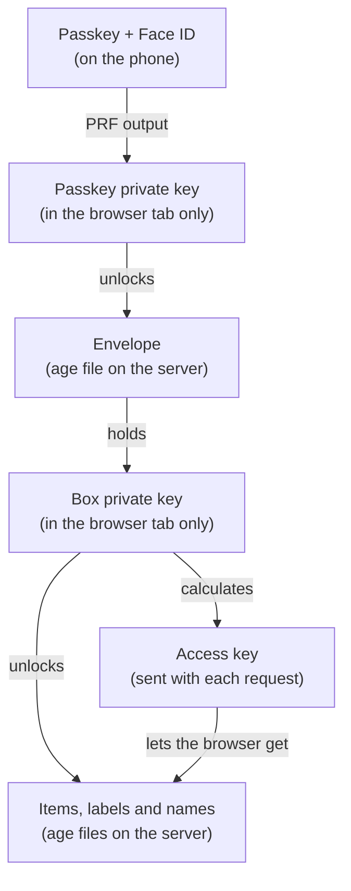
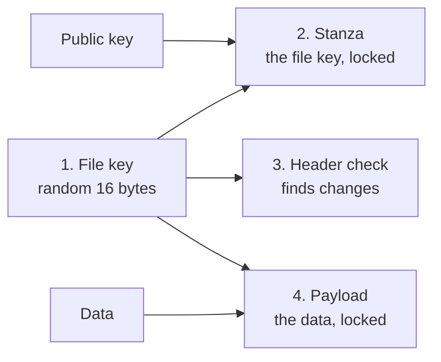

# How Secretbox works

These documents explain what Secretbox does in each situation. They show each key, each file, each lock method and each result. They also show how the result of one step goes into the next step.

The text uses [ASD-STE100 Simplified Technical English](https://www.asd-ste100.org/): short sentences, active voice, one meaning for each word.

## In short

Secretbox keeps shared data in locked boxes. A person opens a box with Face ID or a fingerprint, through a passkey on their phone. The server keeps the boxes, but it cannot open them.

There are no accounts. Each person has one passkey for each box. The phone shows a list of these passkeys, so the list is also the list of the person's boxes.

To give access, a member sends a link. The link works one time. Nobody types an email address.

There are no roles. Each member can read, add items, invite other people and remove members. The person who invites types the name of the new member. The new member types nothing.

## Read this first: padlocks and keys

The system uses pairs of keys. Think of an **open padlock** and **the key that opens it**.

- The **public key** is the open padlock. You can give copies to anybody. Anybody can snap it shut on a box. Nobody can open the box with it.
- The **private key** is the key. Only the person who has it can open what the padlock locked.

In Secretbox, a public key starts with `age1…`. A private key starts with `AGE-SECRET-KEY-1…`.

## The words in these documents

Each word has one meaning in all documents.

| Word | Meaning | Example |
|---|---|---|
| **Lock** | Encrypt. Make data that only the correct key can read. | |
| **Unlock** | Decrypt. Get the original data back with the correct key. | |
| **Public key** | The open padlock. It can lock. It cannot unlock. | `age1aa0rtwwaz8rhsd…` |
| **Private key** | The key that unlocks what its public key locked. | `AGE-SECRET-KEY-174SLE9SKAT…` |
| **Key pair** | A public key and its private key. | |
| **Passkey** | A key in a phone or a password manager. You use it with Face ID or a fingerprint. It has a hidden secret that never leaves the device. | |
| **PRF output** | 32 bytes that a passkey gives for an input, after Face ID. The same passkey and the same input always give the same output. Two passkeys give two different outputs. | `102c876b3d31d206…` |
| **Passkey key** | A key pair that comes from one passkey. The PRF output is its private key. | `age1l88akkymhz39h3…` (public part) |
| **Box key** | One key pair for each box. Each member has the box private key. | |
| **Box ID** | A random name for a box. It is also the user ID of each passkey for that box. | `Ze3WdI5DdSbboy05-E6vhQ` |
| **age file** | A locked file in the [age](https://age-encryption.org) format. Every locked thing in Secretbox is an age file. | |
| **File key** | A random 16-byte key. The system makes a new one for each age file. | `e6e880992a9faf8c…` |
| **Envelope** | An age file that holds the box private key. One passkey key unlocks it. Each member has their own envelope. | |
| **Access key** | A value that the browser calculates from the box private key. It shows the server that a request comes from a member. | `w12HnRha1Tekeupn…` |
| **Access hash** | The SHA-256 hash of the access key. The server keeps only this. | `753a4c5b86ec2461…` |
| **Name file** | An age file that holds a name: the box name, or a person's name and who invited them. The box public key locks it. | |
| **Item** | One piece of data in a box, for example a note or a file. It has two age files: the **label** (name, type, size, who added it) and the **data**. | |
| **Temporary key pair** | A key pair that age makes inside one file, to lock the file key to a public key. age forgets the private part immediately. | `csC1SWy5hBxFb9OH…` (public part) |
| **One-time key** | A key pair that the system makes for one invite link. | |
| **Invite file** | An age file that holds the box private key and two names. The one-time private key unlocks it. | |
| **Add key** | A secret that lets another system add items to a box. It cannot read or delete. | `sbx_…` |

## The big picture

One Face ID starts a chain. Each step gives the key for the next step.

The server keeps the age files and the access hash. It never gets a private key, a PRF output or the data.

## How one age file is made

Every age file has the same four parts. This is the "recipe". The scenario documents show each part with real values.

1. **File key.** The system makes a random 16-byte file key.
2. **Stanza.** The system locks the file key with the public key. The result is one line in the file header.
3. **Header check.** The system calculates a check value (MAC) from the header. If somebody changes the header, the check fails.
4. **Payload.** The system locks the data with a key that comes from the file key.

To unlock, the system goes back: unlock the stanza, get the file key, verify the header check, unlock the payload.

Details: [technical/age-format.md](technical/age-format.md).

## The example people

| Person | What they do |
|---|---|
| **Tiger** | Makes the box "Finance 2026". Later, he makes a second box, "HR 2027". |
| **Nok** | Gets an invite link from Tiger. Later, she invites Bee. |
| **Mallory** | Finds Nok's link after Nok used it. |

All example values are real outputs of the same methods that Secretbox uses. The script simulates one part: the passkeys. A real passkey never shows its hidden secret.

The script [technical/example-data.mjs](technical/example-data.mjs) makes the values. It verifies each file with the real age library, and it compares the keys with the app's own code. The values are in [technical/example-data.json](technical/example-data.json). Each run of the script makes new random values. The documents use the values in the JSON file of this commit.

Tables show long values in a short form. They end with `…`.

## How to read a scenario

Each scenario document has the same parts. The first three parts need no technical knowledge.

| Part | For whom | What it tells |
|---|---|---|
| **In short** | Everybody | The idea, in a few sentences. |
| **What … sees** | Everybody | The steps on the screen. |
| **What happens, in plain words** | Everybody | The steps behind the screen. |
| **Who talks to whom** | Technical readers | A diagram of the messages between the phone, the browser and the server. |
| **How the keys flow** | Technical readers | A diagram of which output goes into which step. |
| **Steps: input, method, output** | Technical readers | A table with real example values. The column "Goes to" shows where each output is used next. |
| **Result** | Everybody | What stays, where it stays, and how many Face IDs are necessary. |

## Scenarios

1. [A person makes a box](01-create-box.md)
2. [A member opens a box later](02-open-box.md)
3. [A member adds an item, and a member reads it](03-add-item.md)
4. [A member makes an invite link](04-create-invite.md)
5. [A person uses an invite link](05-use-invite.md)
6. [An invite link is expired, or another person opens a used link](06-invite-expired-or-reused.md)
7. [What the database keeps](07-storage.md)
8. [Security flaws and limits](08-security.md)

## Technical details

- [age file format: file key, stanzas, header check, payload](technical/age-format.md)
- [Passkey PRF: from a passkey to a passkey key](technical/passkey-prf.md)
- [Passkeys, access keys and add keys](technical/passkeys-and-access-keys.md)
- [API calls and database statements](technical/api-and-sql.md)
