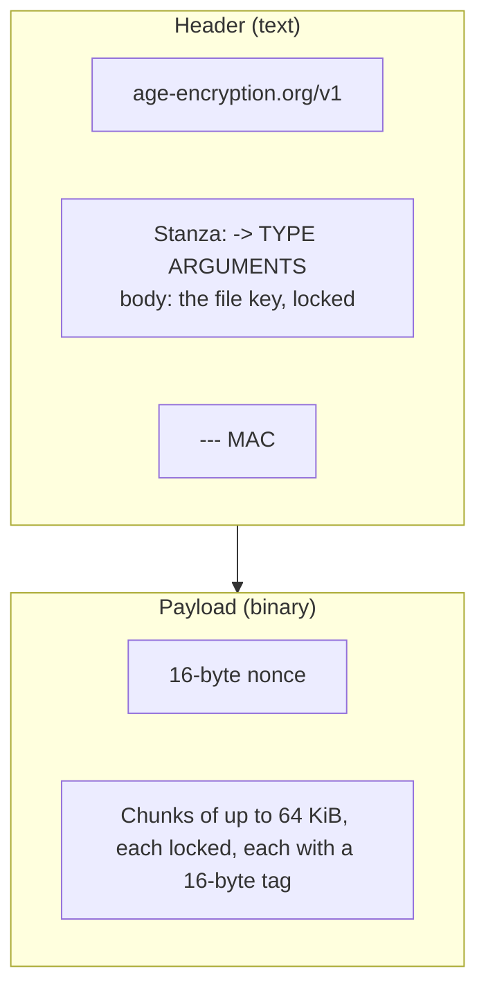

# Technical details: the age file format

[← All documents](../README.md)

Secretbox locks everything with [age v1](https://age-encryption.org/v1), through the TypeScript library [Typage](https://github.com/FiloSottile/typage). This document shows each part of an age file, with real values. The example is the item `note.txt` from [scenario 3](../03-add-item.md).

The script [example-data.mjs](example-data.mjs) makes each value by hand with these formulas. Then it verifies that Typage unlocks each file. If a formula here were wrong, the script would fail.

## The methods

| Name | What it does | Used for |
|---|---|---|
| X25519 | Makes key pairs. Two parties calculate one shared secret. | Member keys, box keys, one-time keys, temporary keys |
| HKDF-SHA-256 | Makes a new key from a secret, a salt and a label (`info`). | Wrap keys, the header MAC key, the payload key |
| HMAC-SHA-256 | Makes a check value (MAC) from a key and a message. | The header check |
| ChaCha20-Poly1305 | Locks data with a 32-byte key and a 12-byte nonce. Adds a 16-byte tag that finds each change. | The stanza body, the payload |

## Keys

An X25519 private key is 32 random bytes. Its public key is 32 bytes too. age writes them in Bech32 text:

| Key | Bech32 prefix | Example (Finance 2026 box key) | Raw bytes |
|---|---|---|---|
| Private key | `AGE-SECRET-KEY-` (upper case) | `AGE-SECRET-KEY-1TECYTY27F3EU674SZFYD4QQVHV6G403U6QE3A2SJU2LYZRKTS82SP5QN4L` | `5e7045915e4c73cd7ab01248da800cbb348abe3cd0331eaa12e2be410ecb81d5` |
| Public key | `age` | `age1cmaf95n0vkusfv0st6wyqgmqtqknwewmn0p0c8el9n9t30lltsss24fc3d` | `c6fa92d26f65b904b1f05e9c402360582d3765db9bc2fc1f3f2ccab8bfff5c21` |

Secretbox makes them with `age.generateX25519Identity()` and `age.identityToRecipient()`.

## The parts of a file



The item `note.txt`:

```
age-encryption.org/v1
-> X25519 /pqZPOaW72Agg6FlpqZc55RhqNRVcUIb5HTZWni73k8
PCuJa75fjmrNPWOPyy3VF7Ax1WEYf/4Rnz4O5y3LUwY
--- d9K/j0cZ5BhNZu2CDKp+oWbsjo5/KmHEBwjpCGPae8A
<16-byte nonce><37 bytes: 21 locked bytes + 16-byte tag>
```

Total: 168 bytes of header + 53 bytes of payload = 221 bytes.

## Step 1: the file key

```
file_key = 16 random bytes
         = cd1ccd6eaec89e98d4f471bb5df883b1
```

The browser uses `crypto.getRandomValues`. age makes a new file key for each file. The file key never leaves the browser in the clear.

## Step 2: the X25519 stanza (lock the file key)

Input: the file key and the recipient's public key. For an item, the recipient is the box public key.

```
recipient       = c6fa92d26f65b904b1f05e9c402360582d3765db9bc2fc1f3f2ccab8bfff5c21   (box public key)

temp_private    = 32 random bytes
                = 3c5433f533e5a1ec9794138608134c16cab69e9948030616885201536dd831ca
temp_public     = X25519(temp_private, basepoint)
                = /pqZPOaW72Agg6FlpqZc55RhqNRVcUIb5HTZWni73k8   (base64, in the stanza line)

shared_secret   = X25519(temp_private, recipient)
                = 23d90d44fd1301f3234f1a6826850651826c853bf06841b9cb1ccf4e36dce911

salt            = temp_public || recipient          (64 bytes)
wrap_key        = HKDF-SHA-256(ikm = shared_secret, salt = salt,
                               info = "age-encryption.org/v1/X25519", length = 32)
                = 6a4b5f84fc12fa7e5ffaa9753dce1f53f87704b2ed1254bb48e358a271159e36

body            = ChaCha20-Poly1305(key = wrap_key, nonce = 12 zero bytes).seal(file_key)
                = PCuJa75fjmrNPWOPyy3VF7Ax1WEYf/4Rnz4O5y3LUwY   (32 bytes: 16 locked + 16 tag)
```

The stanza is two lines:

```
-> X25519 /pqZPOaW72Agg6FlpqZc55RhqNRVcUIb5HTZWni73k8
PCuJa75fjmrNPWOPyy3VF7Ax1WEYf/4Rnz4O5y3LUwY
```

age forgets `temp_private` after this step. A zero nonce is safe here, because each `wrap_key` locks one value only.

### Unlock the stanza

The holder of the box **private** key calculates the same shared secret:

```
shared_secret = X25519(box_private, temp_public)        ← same value as X25519(temp_private, recipient)
wrap_key      = HKDF-SHA-256(shared_secret, temp_public || box_public, "age-encryption.org/v1/X25519")
file_key      = ChaCha20-Poly1305(wrap_key, zero nonce).open(body)
```

If the private key is wrong, the Poly1305 tag check fails. The library then tries the next key. Secretbox gives the current box key and the old box keys from the key history.

## Step 3: the header check (MAC)

```
mac_key = HKDF-SHA-256(ikm = file_key, salt = empty, info = "header", length = 32)
        = 3462dbdb5bdcbccf613fd5cfbb772df025455593f423db29b695bf83f9b1f4a3

message = the header text from "age-encryption.org/v1" up to and including "---"
mac     = HMAC-SHA-256(mac_key, message)
        = d9K/j0cZ5BhNZu2CDKp+oWbsjo5/KmHEBwjpCGPae8A   (base64)
```

The last header line is `--- ` and the MAC. When the library unlocks the file, it calculates the MAC again. If a person changed a stanza, the MAC does not agree, and the library stops.

## Step 4: the payload

```
payload_nonce = 16 random bytes
              = 035cb87a3110c494a6ef28f80a37f813
payload_key   = HKDF-SHA-256(ikm = file_key, salt = payload_nonce, info = "payload", length = 32)
              = af0713c5109785be684b886eb42dd826c0acffd5caa3275b7573141abf721834
```

The library cuts the data into chunks of 64 KiB. The last chunk can be smaller. The library locks each chunk separately:

```
chunk_nonce = 11-byte chunk counter (big endian, from 0) || 1 byte last-chunk flag (0x01 or 0x00)
            = 000000000000000000000001        (chunk 0, and it is the last chunk)
chunk       = ChaCha20-Poly1305(payload_key, chunk_nonce).seal("Salary sheet: Nok 50k")
            = d1cd82a837366fa8a75a7918f47ea621412b3e9c1353c37d6c528ff5660c1e9565e8f92f0d
```

The counter stops a person who changes the order of chunks. The last-chunk flag stops a person who cuts chunks from the end.

Size: 16 (nonce) + 21 (data) + 16 (tag) = 53 bytes.

## How Secretbox uses the format

| File | Stanza type | Recipient | Data in the payload |
|---|---|---|---|
| Envelope | `fido2prf` | The person's passkey | The member private key (74 characters) |
| Key copy | `X25519` | The member public key | The box private key (74 characters) |
| Item | `X25519` | The box public key | The item data |
| Invite file | `X25519` | The one-time public key | The box private key |
| Key history | `X25519` | The current box public key | A JSON list of old box private keys |

The `fido2prf` stanza replaces step 2 only. Steps 1, 3 and 4 are the same. See [passkey-prf.md](passkey-prf.md).

Each Secretbox file has one stanza. age can put many stanzas in one file, one for each recipient. Secretbox does not do this for items. It uses the box key instead, so a new member needs only one new key copy, and no item changes.

## Verify the values yourself

```sh
node docs/technical/example-data.mjs
```

The script prints `All checks passed` and writes [example-data.json](example-data.json). Each run makes new random values.

[← All documents](../README.md)
