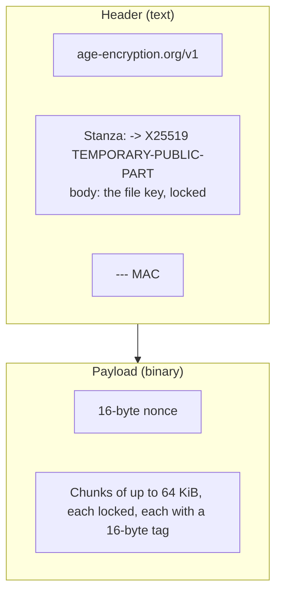

# Technical details: the age file format

[← All documents](../README.md)

Vault Box locks everything with [age v1](https://age-encryption.org/v1), through the TypeScript library [Typage](https://github.com/FiloSottile/typage). This document shows each part of an age file, with real values. The example is the data file of the note from [scenario 3](../03-add-item.md).

The script [example-data.mjs](example-data.mjs) makes each value by hand with these formulas. Then it verifies that Typage unlocks each file. If a formula here were wrong, the script would fail.

## The methods

| Name | What it does | Used for |
|---|---|---|
| X25519 | Makes key pairs. Two parties calculate one shared secret. | Passkey keys, box keys, one-time keys, temporary keys |
| HKDF-SHA-256 | Makes a new key from a secret, a salt and a label (`info`). | Wrap keys, the header MAC key, the payload key |
| HMAC-SHA-256 | Makes a check value (MAC) from a key and a message. | The header check. Also the access key and the passkey PRF, outside age. |
| ChaCha20-Poly1305 | Locks data with a 32-byte key and a 12-byte nonce. Adds a 16-byte tag that finds each change. | The stanza body, the payload |

## Keys

An X25519 private key is 32 bytes. Its public key is 32 bytes too. age writes them in Bech32 text:

| Key | Bech32 prefix | Example (Finance 2026 box key) | Raw bytes |
|---|---|---|---|
| Private key | `AGE-SECRET-KEY-` (upper case) | `AGE-SECRET-KEY-1Z84DDGND8UU933AKFQSVCCX66JS4UKW8A3LP56YWD3L4M06QFSJQ88KH2V` | `11ead6a26d3f3858c7b64820cc60dad4a15e59c7ec7e1a688e6c7f5dbf404c24` |
| Public key | `age` | `age13aa297n0wgzsleu3hhsptlpjajl6a4cwyvhy3fzplhgfk0hsauqqlklqjx` | `8f7aa2fa6f72050fe791bde015fc32ecbfaed70e232e48a441fdd09b3ef0ef00` |

Vault Box makes box keys and one-time keys with `age.generateX25519Identity()`. A passkey key uses the PRF output as the 32 private bytes. See [passkey-prf.md](passkey-prf.md). `age.identityToRecipient()` calculates each public key.

## The parts of a file



The data file of the note:

```
age-encryption.org/v1
-> X25519 AD54KjOicKeazfzd1FA/xo8LMpW2jYkZxPPY2m+GUR8
KtdBzgL4Er4NWxoo845H/GYvQNx4h8YnB49HlcF46/Y
--- Ybz7E174I61mgtDzKu/w9B401BHoANVNRqlKya28DWQ
<16-byte nonce><37 bytes: 21 locked bytes + 16-byte tag>
```

Total: 168 bytes of header + 53 bytes of payload = 221 bytes.

## Step 1: the file key

```
file_key = 16 random bytes
         = 181d2143f6842c5f890af24f31f82511
```

The browser uses `crypto.getRandomValues`. age makes a new file key for each file. The file key never leaves the browser in the clear.

## Step 2: the X25519 stanza (lock the file key)

Input: the file key and the recipient's public key. For an item, the recipient is the box public key.

```
recipient       = 8f7aa2fa6f72050fe791bde015fc32ecbfaed70e232e48a441fdd09b3ef0ef00   (box public key)

temp_private    = 32 random bytes
                = 270f2f3260cbc0a7cc057e24b7bc84c24a004dab194726710e491b97c618d9a6
temp_public     = X25519(temp_private, basepoint)
                = AD54KjOicKeazfzd1FA/xo8LMpW2jYkZxPPY2m+GUR8   (base64, in the stanza line)

shared_secret   = X25519(temp_private, recipient)
                = af7cc562dd4215b2bf245518c329c01e2d6427032e87ae7fdfadcb13d7f17b15

salt            = temp_public || recipient          (64 bytes)
wrap_key        = HKDF-SHA-256(ikm = shared_secret, salt = salt,
                               info = "age-encryption.org/v1/X25519", length = 32)
                = 727033c3be92eef84d50f5bec3f8784500c3a340b71437f20d859b759e429585

body            = ChaCha20-Poly1305(key = wrap_key, nonce = 12 zero bytes).seal(file_key)
                = KtdBzgL4Er4NWxoo845H/GYvQNx4h8YnB49HlcF46/Y   (32 bytes: 16 locked + 16 tag)
```

The stanza is two lines:

```
-> X25519 AD54KjOicKeazfzd1FA/xo8LMpW2jYkZxPPY2m+GUR8
KtdBzgL4Er4NWxoo845H/GYvQNx4h8YnB49HlcF46/Y
```

age forgets `temp_private` after this step. A zero nonce is safe here, because each `wrap_key` locks one value only.

The stanza does not hold the recipient public key. So a person who has the file cannot see which public key locked it. Vault Box uses this: the server cannot know a member's passkey public key from their envelope.

### Unlock the stanza

The holder of the box **private** key calculates the same shared secret:

```
shared_secret = X25519(box_private, temp_public)        ← same value as X25519(temp_private, recipient)
wrap_key      = HKDF-SHA-256(shared_secret, temp_public || box_public, "age-encryption.org/v1/X25519")
file_key      = ChaCha20-Poly1305(wrap_key, zero nonce).open(body)
```

If the private key is wrong, the Poly1305 tag check fails, and the unlock stops with an error.

## Step 3: the header check (MAC)

```
mac_key = HKDF-SHA-256(ikm = file_key, salt = empty, info = "header", length = 32)
        = 64fe47e035af8b17338507487601b36a19164a67c458636ac4dd994b2a669503

message = the header text from "age-encryption.org/v1" up to and including "---"
mac     = HMAC-SHA-256(mac_key, message)
        = Ybz7E174I61mgtDzKu/w9B401BHoANVNRqlKya28DWQ   (base64)
```

The last header line is `--- ` and the MAC. When the library unlocks the file, it calculates the MAC again. If a person changed a stanza, the MAC does not agree, and the library stops.

## Step 4: the payload

```
payload_nonce = 16 random bytes
              = f00dc556ab7e9a0b34ed6f3245bdbc6b
payload_key   = HKDF-SHA-256(ikm = file_key, salt = payload_nonce, info = "payload", length = 32)
              = 1b14184454168d49690e52d9b6346c1851f400819658d4e35c70f134d7468199
```

The library cuts the data into chunks of 64 KiB. The last chunk can be smaller. The library locks each chunk separately:

```
chunk_nonce = 11-byte chunk counter (big endian, from 0) || 1 byte last-chunk flag (0x01 or 0x00)
            = 000000000000000000000001        (chunk 0, and it is the last chunk)
chunk       = ChaCha20-Poly1305(payload_key, chunk_nonce).seal("Salary sheet: Nok 50k")
            = e8a5f50a4bc0804f36ea07b86d69c921ddd365113bc83fd6cd5ccc9743af949035a13ce231
```

The counter stops a person who changes the order of chunks. The last-chunk flag stops a person who cuts chunks from the end.

Size: 16 (nonce) + 21 (data) + 16 (tag) = 53 bytes.

## How Vault Box uses the format

Each file has one X25519 stanza.

| File | Recipient (the public key that locks it) | Data in the payload |
|---|---|---|
| Envelope | The member's passkey public key | The box private key (74 characters) |
| Box name file | The box public key | The box name |
| Member name file | The box public key | `{"name", "invitedBy"}` as JSON |
| Item label | The box public key | `{"name", "type", "size", "addedBy"}` as JSON |
| Item data | The box public key | The item |
| Invite file | The one-time public key | `{"boxKey", "name", "invitedBy"}` as JSON |
| Invite name file | The box public key | `{"name", "invitedBy"}` as JSON |

age can put many stanzas in one file, one for each recipient. Vault Box does not do this. It locks data to the box key, and gives each member the box private key in their own envelope. So a new member needs only one new envelope, and no item changes.

## Verify the values yourself

```sh
node docs/technical/example-data.mjs
```

The script prints `All checks passed` and writes [example-data.json](example-data.json). Each run makes new random values.

[← All documents](../README.md)
