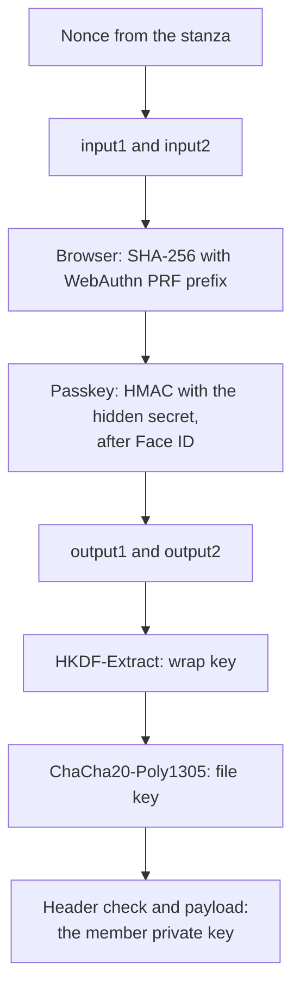

# Technical details: passkey PRF and the fido2prf stanza

[← All documents](../README.md)

A passkey can sign, but it cannot unlock. The **PRF extension** of WebAuthn adds one function: the passkey calculates a fixed 32-byte value from an input. Typage uses this value to lock and unlock the file key of an age file. The stanza type is `age-encryption.org/fido2prf`.

The example is Tiger's envelope from [scenario 1](../01-new-user-new-box.md). The example simulates the passkey, because a real passkey never shows its hidden secret.

## PRF: input and output

```
output = HMAC-SHA-256(hidden_secret, SHA-256("WebAuthn PRF" || 0x00 || input))
```

| Who | What it does |
|---|---|
| The web page | Gives an input. |
| The browser | Calculates `SHA-256("WebAuthn PRF" || 0x00 || input)`. This makes sure that a web page cannot send raw values to the passkey. |
| The passkey | Asks for Face ID or a fingerprint. Then it calculates the HMAC with its hidden secret. The CTAP2 name for this is `hmac-secret`. |
| The browser | Gives the 32-byte output to the page. The hidden secret stays in the passkey. |

Properties:

| Property | Meaning |
|---|---|
| Repeatable | The same passkey and the same input always give the same output. |
| Unpredictable | A different input gives an output that has no relation to the first output. |
| Personal | A different passkey gives a different output for the same input. |
| One-way | The output does not show the hidden secret. |
| Needs the person | The passkey requires user verification (Face ID, fingerprint or PIN) for each request. |

One request can calculate two outputs: `first` and `second`.

### The browser call

```js
const credential = await navigator.credentials.get({
  publicKey: {
    allowCredentials: [{ type: "public-key", id: credentialId, transports }],
    challenge: random16,             // not used by Secretbox
    userVerification: "required",
    extensions: { prf: { eval: { first: input1, second: input2 } } },
  },
});
const { first, second } = credential.getClientExtensionResults().prf.results;
```

## The fido2prf stanza: lock a file key

```
label  = "age-encryption.org/fido2prf"
nonce  = 16 random bytes                    → rz/XB5+tax7mwcIJowbCPQ (base64, in the stanza line)

input1 = label || 0x01 || nonce
       = 6167652d656e6372797074696f6e2e6f72672f6669646f3270726601af3fd7079fad6b1ee6c1c209a306c23d
input2 = label || 0x02 || nonce
       = 6167652d656e6372797074696f6e2e6f72672f6669646f3270726602af3fd7079fad6b1ee6c1c209a306c23d
```

The browser hashes each input:

```
salt1 = SHA-256("WebAuthn PRF" || 0x00 || input1) = 6fef2f565bb9518e57f11c4db9a6b1a9fb5f8d8901ac2774a243d21fea879d89
salt2 = SHA-256("WebAuthn PRF" || 0x00 || input2) = 1f19f1ac8eb727015e73d9d1099b537c3f6f33618f37de3b075ee546d92024ef
```

After Face ID, the passkey calculates:

```
output1 = HMAC-SHA-256(hidden_secret, salt1) = add6282257e13a4caa17202b171827d4f0d7eb05985d333b065865ffdcb01d76
output2 = HMAC-SHA-256(hidden_secret, salt2) = 752b4f4795cd974d5fe7b0dc1a673e7a8f2f776f7ef67d4c8c0e5e4427c98cfe
```

Typage makes the wrap key and locks the file key:

```
wrap_key = HKDF-Extract(SHA-256, salt = label, ikm = output1 || output2)
         = 7b1ee88fcb85256e0265cefbe65fa5f7e58bb547b640a73ecb8937b26e09fbfb

file_key = bd991a3d7a99a5c2f3863b04757ce9ee
body     = ChaCha20-Poly1305(wrap_key, 12 zero bytes).seal(file_key)
         = xnsO+7fJA1pe0ly2jfVIiOX/HbmnRrUdu+31Z4b8MLM
```

The stanza:

```
-> age-encryption.org/fido2prf rz/XB5+tax7mwcIJowbCPQ
xnsO+7fJA1pe0ly2jfVIiOX/HbmnRrUdu+31Z4b8MLM
```

The rest of the file (header check and payload) is the same as for all age files. See [age-format.md](age-format.md).

## Unlock



The steps are the same as the lock steps. The nonce comes from the stanza line. Because PRF is repeatable, the outputs and the wrap key are the same. If the passkey is wrong, the outputs are different and the Poly1305 tag check fails.

## Why two outputs

The file needs **both** outputs. One passkey request gives at most two outputs. So one Face ID can unlock one file only. A changed page cannot unlock a second file with the same Face ID.

## Why a new nonce for each file

Each file has its own nonce, so each file has its own wrap key. Without the passkey, nobody can see that two envelopes belong to the same passkey.

## Why only the owner can lock

The lock steps also need the passkey and Face ID. This is a **symmetric** lock: there is no public part. Another member cannot lock data for Nok's passkey.

This is why Secretbox has a member key between the passkey and the box key. The member **public** key lets other members lock key copies for Nok at any time, without her passkey.

## How the page selects the correct passkey

Typage accepts an identity string. With it, the browser asks for this passkey only. The string is Bech32 text of a small CBOR value:

```
CBOR [ 1, credential ID (bytes), passkey domain (text), transports (list of text) ]
```

Secretbox builds this string in `web/src/keys.ts` (`passkeyIdentity`). It uses the credential ID and the transports from the server, and the domain of the page. For Tiger:

| Part | Value |
|---|---|
| Version | `1` |
| Credential ID | `nIqF2ASScSdBg5JqLm1Kcw` |
| Passkey domain | `secretbox-nu.vercel.app` |
| Transports | `["internal", "hybrid"]` |
| CBOR bytes | `01509c8a85d8049271274183926a2e6d4a7377736563…` |
| Identity string | `AGE-PLUGIN-FIDO2PRF-1Q9GFEZ59MQZFYUF8GXPEY63WD498XAMNV43HYET5VFHHSTTWW5H8VETJVDJKCTNPWPCGY6RFDE6X2UNWV9KXV6REVFEXJEQWY53SY` |

Typage's own CBOR reader decodes this string correctly. The string is not secret: it only names the passkey.

## Limits

- The passkey works only on its domain. Secretbox passkeys work only on `secretbox-nu.vercel.app`.
- The provider must support PRF. Apple Passwords and Google Password Manager do. Some other password managers do not. The server checks `prf.enabled` during sign-up and refuses passkeys without PRF.
- Typage marks this function as experimental.

[← All documents](../README.md)
