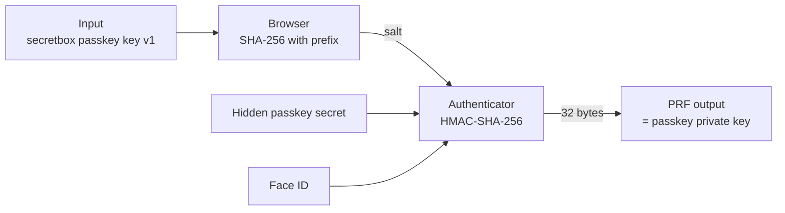

# Technical details: passkey PRF

[← All documents](../README.md)

This document shows how one passkey gives one **passkey key**: an age X25519 key pair. The passkey key locks and unlocks the member's envelope. Steps C3–C4 of [scenario 1](../01-create-box.md), O1–O2 of [scenario 2](../02-open-box.md) and J7–J8 of [scenario 5](../05-use-invite.md) use it.

The code is in [web/src/passkey.ts](../../web/src/passkey.ts).

## What PRF is

PRF is a WebAuthn extension ([spec](https://w3c.github.io/webauthn/#prf-extension)). It uses the CTAP2 `hmac-secret` extension of the authenticator.

- When the authenticator makes a passkey, it also makes a random secret for it. This secret never leaves the authenticator.
- For each request, the authenticator calculates HMAC-SHA-256 with that secret and a salt. The result is 32 bytes.
- The authenticator does this only after user verification: Face ID, a fingerprint or a PIN.

The website does not send the salt directly. The browser makes it from the website's input:

```
salt       = SHA-256("WebAuthn PRF" || 0x00 || input)       ← the browser
prf_output = HMAC-SHA-256(passkey_secret, salt)              ← the authenticator
```

The prefix stops a website from asking for values that another protocol uses.



## The input and the outputs

Secretbox always uses the same input: `secretbox passkey key v1`.

```
input        = "secretbox passkey key v1"
salt         = SHA-256("WebAuthn PRF" || 0x00 || input)
             = 760aa987e59e5f6d53840635dba57a7b90bb8458653b9a36319afd4cd7406cb4
```

Each passkey has its own hidden secret, so each passkey gives a different output:

| Passkey | Hidden secret (simulated) | PRF output |
|---|---|---|
| Finance 2026 – Tiger | `f65b8482512addd8…` | `102c876b3d31d206f10e639306a2e8477845c7a78b9676faa1b3c2b19d739499` |
| HR 2027 – Tiger | `247d74f9872fe2ed…` | `07137eb0500ce07eb7ab4ce642800f83c626da4db8ae5d261a0b1b6efa944d75` |
| Finance 2026 – Nok | `a9dbe58eb2103f12…` | `e569a0f8789aec478271a2a84ac0f039af616dd9ecf61dca5b310d980358381f` |

A real passkey never shows its hidden secret. The script [example-data.mjs](example-data.mjs) simulates it with the same formulas.

The same passkey and the same input always give the same output. So the browser gets the same passkey key each time Tiger opens the box.

## From the PRF output to the passkey key

The 32 bytes of the PRF output are the X25519 private key. No other step is necessary.

```
passkey_private = prf_output                                   (32 bytes)
                = 102c876b3d31d206f10e639306a2e8477845c7a78b9676faa1b3c2b19d739499
as text         = Bech32("AGE-SECRET-KEY-", passkey_private), upper case
                = AGE-SECRET-KEY-1ZQKGW6EAX8FQDUGWVWFSDGHGGAUYT3A83WT8D74PK0PTR8TNJJVSPV3UMU
passkey_public  = X25519(passkey_private, basepoint)
as text         = age1l88akkymhz39h3fthp04q8ghcxt626aqjc3lztyx5s3er96x25dstpqevm
```

In the code:

```ts
const identity = bech32.encode("AGE-SECRET-KEY-", bech32.toWords(prfOutput), false).toUpperCase();
const recipient = await age.identityToRecipient(identity);
```

**Why the output can be the key directly.** An X25519 private key can be any 32 bytes. X25519 sets a few bits itself ("clamping"). The PRF output is 32 bytes from HMAC-SHA-256, so it is uniformly random for anybody without the passkey. Secretbox uses this input for this one purpose only. The `v1` in the input lets a later version make different keys.

## Make a passkey (scenarios 1 and 5)

```ts
navigator.credentials.create({ publicKey: {
  rp: { id: location.hostname, name: "Secretbox" },
  user: { id: utf8(boxId), name: "Finance 2026 – Nok", displayName: "Finance 2026 – Nok" },
  challenge: randomBytes(32),
  pubKeyCredParams: [{ type: "public-key", alg: -7 }, { type: "public-key", alg: -8 }, { type: "public-key", alg: -257 }],
  authenticatorSelection: { residentKey: "required", userVerification: "required" },
  extensions: { prf: { eval: { first: utf8("secretbox passkey key v1") } } },
} })
```

| Option | Why |
|---|---|
| `user.id` = the box ID | One passkey for each box. A new passkey with the same user ID replaces the old one on that device. The box ID comes back when a person uses the passkey. |
| `user.name` = box name and person name | The phone shows it in its passkey list. See [flaw 9](../08-security.md#9-the-passkey-label-shows-the-box-name-and-the-persons-name). |
| `residentKey: "required"` | The passkey must be "discoverable", so the phone can list it without a credential ID from the website. |
| `userVerification: "required"` | PRF needs Face ID, a fingerprint or a PIN. |
| `challenge` | Random, but nobody checks it. The server does not use the passkey to sign in. |
| `prf.eval` | Ask for the PRF output now. |

The answer has `prf.enabled`. If it is not `true`, the passkey cannot give a PRF output, and the browser stops with a message.

**One or two Face IDs.** Some authenticators calculate the PRF output while they make the passkey. Then the answer has `prf.results.first`, and one Face ID is enough. Other authenticators give only `prf.enabled: true`. Then the browser uses the new passkey one time, with `allowCredentials` set to its credential ID. That is the second Face ID.

## Use a passkey (scenario 2)

```ts
navigator.credentials.get({ publicKey: {
  rpId: location.hostname,
  challenge: randomBytes(32),
  userVerification: "required",
  allowCredentials: [],
  extensions: { prf: { eval: { first: utf8("secretbox passkey key v1") } } },
} })
```

`allowCredentials: []` lets the phone show all passkeys of the site. The person selects one. The answer gives:

| Field | Example | Use |
|---|---|---|
| `rawId` | `jnx3yrksw0nZ_pk2v1xPmQ` (base64url) | Finds the member row: `GET /api/boxes/:id/envelopes/:credentialId` |
| `response.userHandle` | `Ze3WdI5DdSbboy05-E6vhQ` | The box ID |
| `prf.results.first` | `102c876b3d31d206…` | The passkey private key |

So one Face ID gives the box, the passkey and the key. The browser needs no list of boxes.

## Why not the fido2prf stanza

The first version of Secretbox used Typage's passkey support: a `fido2prf` stanza in the envelope. That stanza uses a new random nonce for each file, and the nonce is part of the PRF input. So the browser must have the file, and know the passkey, **before** it asks for Face ID.

Without accounts, the browser does not know the box before the person selects a passkey. With the `fido2prf` stanza, it would need two Face IDs: one to find the passkey, and one for the PRF output. Or each device would need a list of passkeys.

A fixed input gives one key for each passkey. One Face ID is then enough. The cost: the envelope now uses an X25519 stanza, like the other files. See [flaw 7](../08-security.md#7-x25519-is-not-safe-against-future-quantum-computers).

## Support

| Passkey provider | PRF |
|---|---|
| Apple Passwords (iOS 18, macOS 15 and later) | Yes |
| Google Password Manager (Chrome 132 and later) | Yes |
| Recent security keys (`hmac-secret`) | Yes |
| Some other password managers | No, or not yet |

The end-to-end test uses Chrome's virtual authenticator with PRF. It also tests a device that gives the PRF output only when a person uses a passkey.

[← All documents](../README.md)
