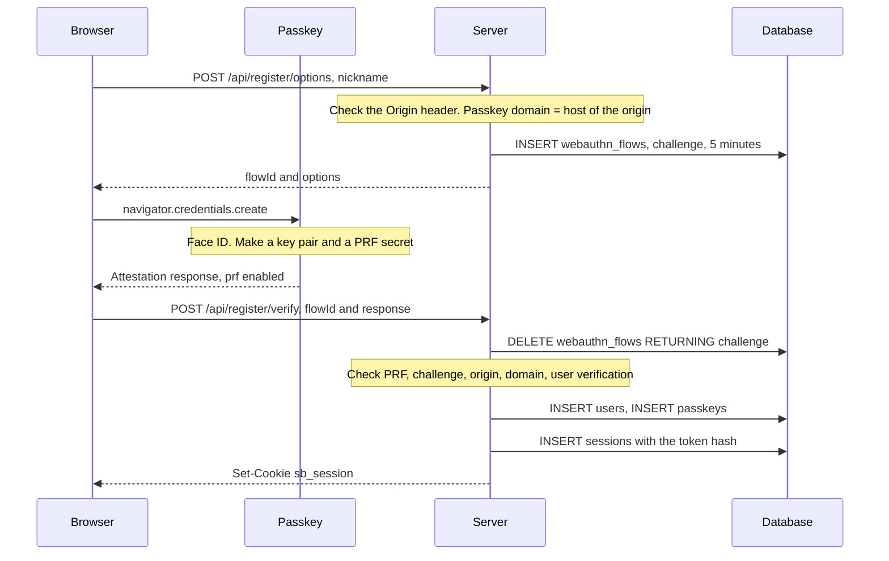

# Technical details: passkey sign-up, sign-in and sessions

[← All documents](../README.md)

Secretbox uses one passkey for two jobs:

1. **Sign-in to the server.** This is normal WebAuthn. The server keeps the passkey public key and verifies signatures. The library is [SimpleWebAuthn](https://simplewebauthn.dev).
2. **Unlock the envelope.** This uses the PRF extension. See [passkey-prf.md](passkey-prf.md).

This document is about job 1.

## Sign-up (registration)

### Options that the server sends

| Option | Value | Why |
|---|---|---|
| `rp.id` | The host of the request origin, for example `secretbox-nu.vercel.app` | The passkey works only on this domain. |
| `rp.name` | `Secretbox` | The phone shows it. |
| `user.id` | 32 random bytes | Not the email or the name. |
| `user.name` | The nickname | The phone shows it. |
| `challenge` | 32 random bytes | The server keeps it in `webauthn_flows` for 5 minutes. |
| `authenticatorSelection.residentKey` | `required` | A discoverable passkey. Sign-in needs no user name. |
| `authenticatorSelection.userVerification` | `required` | Face ID, fingerprint or PIN each time. PRF also requires it. |
| `attestation` | `none` | Secretbox does not check the device model. |
| `pubKeyCredParams` | Ed25519, ES256, RS256 (and ML-DSA-44 if the server runtime supports it) | The library defaults. |
| `extensions.prf` | `{}` | Asks the passkey to turn on PRF. |

### Checks on the response

| Check | Result if it fails |
|---|---|
| `clientExtensionResults.prf.enabled` is `true` | `400`: "This passkey provider does not support PRF…" |
| The challenge is the one from `webauthn_flows`, not expired, used one time | `400`: "Passkey request expired" |
| The origin in `clientDataJSON` is the origin from the options request | `400`: "Passkey check failed" |
| `rpIdHash` is SHA-256 of the passkey domain | `400` |
| The user-verified flag is set | `400` |

The server keeps the credential ID, the COSE public key, the signature counter and the transports in `passkeys`.

## Sign-in (authentication)

| Step | Input | Method | Output |
|---|---|---|---|
| 1 | The request origin | `POST /api/login/options`. A new challenge goes into `webauthn_flows`. | Options with no `allowCredentials`. The person selects a passkey on the phone. |
| 2 | Face ID | `navigator.credentials.get` | A signature over `authenticatorData || SHA-256(clientDataJSON)` |
| 3 | The signature and the credential ID | `POST /api/login/verify`. The server finds the passkey row and verifies the signature with the kept public key. | A new session |

The server also checks the signature counter. If the counter is not 0 and it does not increase, the server refuses the sign-in. Synced passkeys usually send 0.

## Sessions

| Item | Value |
|---|---|
| Token | 32 random bytes, base64url. Example: `vjCmUsAHogdl4B-Y0hJf1o8eVGReIhp5MuwJTF3EkpE` |
| Database | Only `SHA-256(token)`. Example: `a01c59a2922989161f555a82f2cac2240d80e21bf9f09838d39e1209ef7a9204` |
| Cookie | `sb_session`, `HttpOnly`, `SameSite=Lax`, `Secure` on HTTPS, `Path=/` |
| Lifetime | 30 days |
| Sign out | Deletes the current session row only. |

`HttpOnly` means that page scripts cannot read the token. A person who reads the database gets only hashes, which do not work as cookies.

## Which addresses are allowed

Each address is its own passkey domain. A passkey made on one address does not work on another.

| Where the server runs | Allowed origins |
|---|---|
| Vercel | `https://` + `VERCEL_PROJECT_PRODUCTION_URL` (`secretbox-nu.vercel.app`), `VERCEL_BRANCH_URL` and `VERCEL_URL`. Also each origin in `ORIGINS`. |
| Local | `ORIGINS`, or by default `http://localhost:8787` and `http://localhost:5173`. |

The server reads the origin from the `Origin` header of the request. If the origin is not allowed, the server refuses with `403`.

## Protection against requests from other websites

| Protection | How |
|---|---|
| Custom header | Each `POST`, `PUT` and `DELETE` must have `x-secretbox: 1`. A different website cannot send this header without a CORS check, and the server never allows CORS. |
| Cookie | `SameSite=Lax`. Browsers do not send it with `POST` requests from other websites. |
| Exception | `POST /api/ingest/:boxId` uses an ingest token in the `Authorization` header, not a cookie. |

[← All documents](../README.md)
